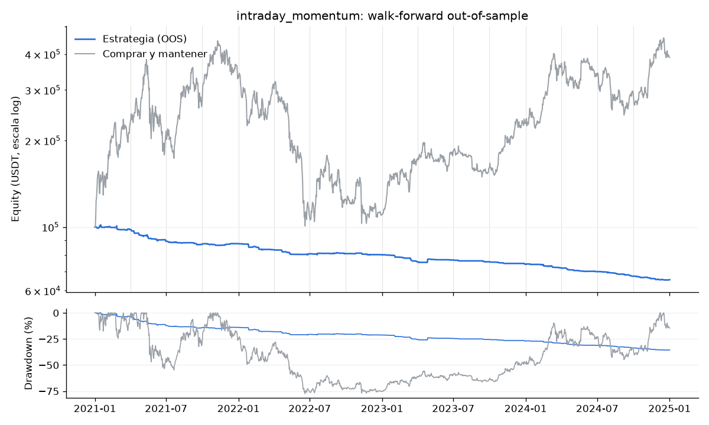

# Resultados del IntradayMomentumAgent: walk-forward 2021–2024

Backtest formal del [IntradayMomentumAgent](../../services/agents/src/tm_agents/strategies/intraday_momentum.py) (Shen, Urquhart y Wang, 2022) con el laboratorio del #13. La definición del paper y la adaptación están en [intraday-momentum.md](intraday-momentum.md). Issue: #32.

> **Veredicto: RECHAZADO.** Sharpe out-of-sample de −2.56 (se requiere > 0.5) y drawdown p95 de 42.6 % (se requiere < 40 %). Pierde 34.5 % en 4 años mientras comprar y mantener gana 290 %. Las comisiones (35,945 USDT, 36 % del capital) explican la mayor parte, pero **ni siquiera sin comisiones** tiene ventaja en este periodo (Sharpe −0.54). Confirma el chequeo rápido de [intraday-momentum.md](intraday-momentum.md): la estrategia se queda en `research` y no recibe capital.

## 1. Cómo se corrió

```bash
uv run --package tm-engine python -m tm_engine.lab run --strategy intraday_momentum --symbols BTCUSDT ETHUSDT --data-dir data/bars --out-dir docs/estrategias/reportes
```

- **Walk-forward** (`tm_engine.lab.walk_forward`): 16 tramos. En cada uno se ajusta con 12 meses (in-sample) y se prueba en los 3 siguientes (out-of-sample), de 2021-T1 a 2024-T4. Los tramos out-of-sample se pegan en una sola corrida continua de 4 años (las posiciones pasan de un tramo al siguiente).
- **Datos**: velas de Binance Spot de BTCUSDT y ETHUSDT de 30 min, 2020-01-01 a 2024-12-31. **El holdout 2025 no se cargó** (la guarda de `WalkForwardConfig` lo impide sin `--holdout`).
- **Capital**: 100,000 USDT repartidos por igual entre BTC y ETH. En spot, `long` = comprar con todo el efectivo del sub-sleeve y `flat` = vender y quedarse en USDT; no hay cortos.
- **Costos**: comisión de 0.1 % por lado (Binance Spot), cobrada en USDT sobre el nocional. Las órdenes se llenan al cierre de la vela en la que se decide (sin look-ahead).
- **Ejecución**: el out-of-sample se ejecuta en **Nautilus** (`tm_engine.backtest.run_backtest`, venue simulado de Binance). La cuadrícula in-sample usa un simulador vectorizado equivalente (`tm_engine.lab.simulator`); el reporte compara los dos en la misma corrida y la diferencia del equity diario es < 1e-9 (ver la última sección).
- **Optimización in-sample**: `mode` (`onfh`, `slh` o `both`) × `threshold` (0, 0.25 %, 0.5 % o 1 %; en `slh` no aplica), 9 combinaciones. La apertura del reloj de volumen (`volume_clock_open`) se vuelve a ajustar en cada ventana solo con las velas in-sample. El sleeve compra al cierre de la vela de las 16:00 ET (16:30) y vende al cierre de la de las 16:30 ET (17:00), como el agente, y solo opera la pata larga. Se elige la combinación con mayor Sharpe in-sample (diario, anualizado con 365 días).
- **Métricas**: sobre la **serie diaria de equity** del sleeve con las posiciones abiertas valuadas a mercado (00:00 UTC). Sharpe con 365 días y tasa libre de riesgo 0.
- **Monte Carlo**: `tm_agents.montecarlo.bootstrap` sobre los 1,461 retornos diarios out-of-sample (bloques de 20 días, 10,000 simulaciones, semilla 42) y `evaluate(..., oos_years=4)` con `ApprovalCriteria(max_drawdown_p95=0.40)`: Sharpe > 0.5, drawdown p95 a tamaño completo < 40 % (techo global de [criterios-de-aprobacion.md](criterios-de-aprobacion.md)) y ≥ 100 trades, o ≥ 30 con ≥ 3 años out-of-sample. El reporte también da la exposición por nivel de riesgo, `min(1, drawdown del nivel / p95)`.
- **Reporte completo** (por ventana, la cuadrícula in-sample y la serie diaria de equity en JSON): [`reportes/intraday_momentum.json`](reportes/intraday_momentum.json).

## 2. Resultados

### Agregado out-of-sample contra comprar y mantener

| | Estrategia | Comprar y mantener |
|---|---|---|
| Periodo | 2021-01-01 a 2025-01-01 | igual |
| Retorno total | -34.5 % | 290.0 % |
| CAGR | -10.0 % | 40.5 % |
| Sharpe (365 d) | -2.56 | 0.83 |
| Volatilidad anual | 4.1 % | 71.6 % |
| Drawdown máximo | 35.6 % | 77.4 % |
| Equity final (de 100,000 USDT) | 65,524 | 389,974 |
| Trades | 444 (111 al año) | 2 |
| Duración mediana de un trade | 0.5 horas | — |
| Trades ganadores | 30.4 % | — |
| Comisiones pagadas | 35,945 USDT (35.9 % del capital) | — |
| Tiempo con posición | 0.3 % | 100 % |
| Años out-of-sample | 4.00 | — |



### Por símbolo

| Símbolo | Retorno | Sharpe | Drawdown | Trades | Comisiones | Retorno B&H | Sharpe B&H | Drawdown B&H |
|---|---|---|---|---|---|---|---|---|
| BTCUSDT | -35.2 % | -2.60 | 36.2 % | 208 | 16,655 | 224.2 % | 0.78 | 76.6 % |
| ETHUSDT | -33.8 % | -1.95 | 35.0 % | 236 | 19,290 | 355.8 % | 0.87 | 79.3 % |

### Por ventana (walk-forward)

| Tramo OOS | In-sample | Parámetros elegidos | Sharpe IS | Retorno OOS | Sharpe OOS | Drawdown OOS | Trades | Comisiones | Retorno B&H |
|---|---|---|---|---|---|---|---|---|---|
| 2021-T1 | 2020-01 a 2020-12 | both u=1.00% apertura 03:00 ET | -0.82 | -2.0 % | -1.01 | 3.9 % | 41 | 4,071 | 132.8 % |
| 2021-T2 | 2020-04 a 2021-03 | both u=1.00% apertura 03:00 ET | -0.68 | -8.9 % | -5.05 | 8.9 % | 33 | 3,068 | -7.2 % |
| 2021-T3 | 2020-07 a 2021-06 | both u=1.00% apertura 11:00 ET | -2.40 | -2.3 % | -3.21 | 2.8 % | 41 | 3,609 | 29.9 % |
| 2021-T4 | 2020-10 a 2021-09 | both u=1.00% apertura 03:00 ET | -2.07 | 0.3 % | 0.63 | 1.3 % | 27 | 2,349 | 17.9 % |
| 2022-T1 | 2021-01 a 2021-12 | both u=1.00% apertura 03:00 ET | -2.30 | -4.7 % | -3.19 | 5.0 % | 26 | 2,210 | -8.5 % |
| 2022-T2 | 2021-04 a 2022-03 | both u=1.00% apertura 09:30 ET | -3.23 | -3.3 % | -3.40 | 4.1 % | 20 | 1,625 | -64.5 % |
| 2022-T3 | 2021-07 a 2022-06 | both u=1.00% apertura 09:30 ET | -2.37 | 0.2 % | 0.26 | 0.8 % | 31 | 2,509 | 15.5 % |
| 2022-T4 | 2021-10 a 2022-09 | both u=1.00% apertura 09:30 ET | -2.16 | -1.0 % | -1.67 | 1.5 % | 24 | 1,938 | -11.3 % |
| 2023-T1 | 2022-01 a 2022-12 | both u=1.00% apertura 09:30 ET | -2.33 | -5.5 % | -6.15 | 5.5 % | 31 | 2,432 | 57.4 % |
| 2023-T2 | 2022-04 a 2023-03 | both u=1.00% apertura 09:30 ET | -2.94 | 1.5 % | 1.17 | 0.7 % | 22 | 1,685 | 6.4 % |
| 2023-T3 | 2022-07 a 2023-06 | both u=1.00% apertura 09:30 ET | -1.29 | -1.4 % | -4.05 | 1.4 % | 7 | 535 | -13.0 % |
| 2023-T4 | 2022-10 a 2023-09 | both u=1.00% apertura 09:30 ET | -1.81 | -2.0 % | -5.00 | 2.0 % | 16 | 1,203 | 42.5 % |
| 2024-T1 | 2023-01 a 2023-12 | both u=1.00% apertura 09:30 ET | -2.14 | -3.1 % | -3.50 | 3.3 % | 33 | 2,418 | 62.6 % |
| 2024-T2 | 2023-04 a 2024-03 | both u=1.00% apertura 09:30 ET | -1.44 | -2.8 % | -6.31 | 2.8 % | 26 | 1,842 | -7.8 % |
| 2024-T3 | 2023-07 a 2024-06 | both u=1.00% apertura 09:30 ET | -4.15 | -3.6 % | -6.24 | 3.6 % | 27 | 1,865 | -16.3 % |
| 2024-T4 | 2023-10 a 2024-09 | both u=1.00% apertura 09:30 ET | -4.75 | -2.8 % | -4.89 | 3.0 % | 39 | 2,586 | 35.7 % |

La estrategia le ganó en retorno a comprar y mantener en 6 de 16 tramos.

### Estabilidad de los parámetros

- 3 combinaciones distintas en 16 tramos y 3 cambios entre tramos consecutivos.
- La más frecuente (`both u=1.00% apertura 09:30 ET`) se eligió en 69 % de los tramos.

| Parámetros | Tramos |
|---|---|
| both u=1.00% apertura 09:30 ET | 11 |
| both u=1.00% apertura 03:00 ET | 4 |
| both u=1.00% apertura 11:00 ET | 1 |

### Monte Carlo del drawdown

Block bootstrap de los 1461 retornos diarios out-of-sample del sleeve (bloques de 20 días, 10,000 simulaciones, semilla 42). Cada simulación cubre el mismo horizonte que el backtest.

| Drawdown máximo | p50 | p95 | p99 |
|---|---|---|---|
| Simulado | 34.9 % | 42.6 % | 45.5 % |

Probabilidad de ruina (perder la mitad del capital en algún punto): 0.0 %.

Como referencia, con el mismo bootstrap pero en horizontes de un año (el criterio habla de "un año malo"): p50 10.6 %, p95 15.8 % y p99 18.0 %. El veredicto usa el horizonte completo, que es más exigente.

### Criterios de aprobación

| Criterio | Valor | Umbral | ¿Pasa? |
|---|---|---|---|
| Sharpe out-of-sample | -2.56 | > 0.50 | no |
| Drawdown p95 | 42.6 % | < 40 % | no |
| Evidencia (trades) | 444 en 4.0 años | ≥ 100, o ≥ 30 con ≥ 3 años | sí |

Exposición por nivel de riesgo si se aprobara, `min(1, drawdown del nivel / p95)`: nivel 1: 23 %, nivel 2: 35 %, nivel 3: 47 %, nivel 4: 70 %, nivel 5: 94 %.

Sharpe contra comprar y mantener (propuesta pendiente de aprobación, no entra al veredicto): -2.56 contra 0.83, no le gana.

### Ejecución: Nautilus contra el simulador vectorizado

- Nautilus (`run_backtest`, comisión de 0.1 % por lado): equity final de 65,524 USDT con 888 fills en 2.8 s.
- Simulador vectorizado: 65,524 USDT. Diferencia relativa máxima del equity diario: 0.000 %.
- Decisiones rechazadas por el motor: 0.

## 3. Lectura

1. **Ninguna combinación gana in-sample.** El Sharpe in-sample del mejor parámetro es negativo en los 16 tramos. Por eso la optimización elige casi siempre `both` con el umbral más alto (1 %): es la que menos opera y por lo tanto la que menos pierde. Es una señal de que no hay ventaja que optimizar, no de que el parámetro sea bueno.
2. **La comisión se come todo.** Cada trade dura media hora y paga 20 pb de ida y vuelta. Con 444 trades se pagaron 35,945 USDT; la volatilidad del sleeve es de solo 4 % al año porque está en el mercado 0.3 % del tiempo, así que la pérdida constante por comisiones da un Sharpe muy negativo.
3. **Sin comisiones tampoco hay ventaja.** Con la misma corrida y `--fee 0` (diagnóstico, motor vectorizado): Sharpe out-of-sample de −0.54, retorno de −11.8 % y 839 trades con 54.6 % ganadores. En los 16 tramos la cuadrícula eligió 10 combinaciones distintas (ninguna más de 4 veces): los parámetros no son estables. El efecto del paper (datos de 2013–2020, sin costos) no aparece en BTC/ETH de Binance en 2021–2024.
4. **El Monte Carlo** da un drawdown p95 de 42.6 % sobre 4 años; no es un riesgo de colas, sino la acumulación lenta de comisiones (el p95 en horizontes de un año es de 15.8 %).
5. **Para revivirla** haría falta una comisión mucho menor (cuenta *maker* o VIP), apalancamiento (fuera de alcance en spot) o un filtro de volumen y volatilidad como el de la tabla 4 del paper. Nada de eso se probó aquí.

## 4. Holdout 2025: pendiente

El holdout (2025-01-01 a 2025-12-31) **no se ha corrido**. Se corre una sola vez al final del desarrollo, con los parámetros que elija la última ventana:

```bash
uv run --package tm-engine python -m tm_engine.lab run --strategy intraday_momentum --symbols BTCUSDT ETHUSDT --data-dir data/bars --out-dir docs/estrategias/reportes --holdout
```

Escribe `reportes/intraday_momentum-holdout.json`, `.md` y `.png` y no sobrescribe este reporte.

Dado el resultado, no tiene sentido gastar el holdout en esta estrategia salvo que una versión nueva pase primero el walk-forward.

## 5. Limitaciones

- Sin deslizamiento: las órdenes se llenan al cierre de la vela de 30 min. Con trades de media hora, el deslizamiento real empeoraría el resultado.
- Solo la pata larga (Binance Spot no permite cortos); el paper también usa la corta.
- La guarda contra días festivos o con huecos de datos es la del agente: si falta la vela de las 16:00 ET, ese día no opera.
