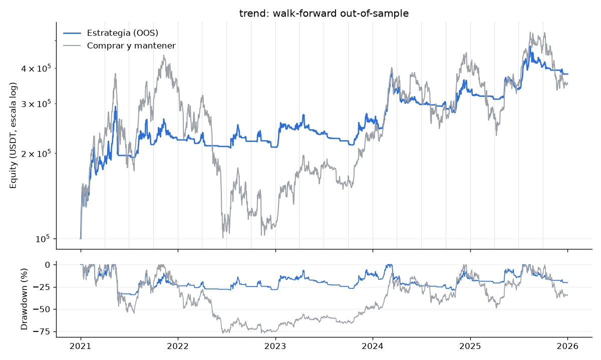
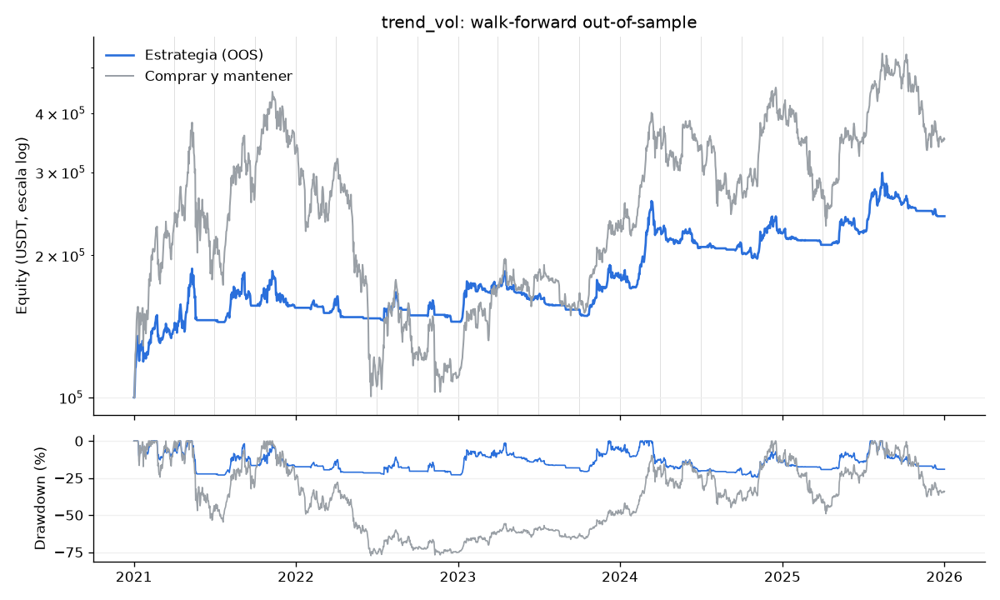

# Resultados del TrendAgent: walk-forward 2021–2025

Backtest formal del [TrendAgent](../../services/agents/src/tm_agents/strategies/trend.py) (conjunto de canales Donchian en velas diarias) con el laboratorio del #13, en dos variantes: sin y con *volatility targeting* (#83). Issues: #31 y #83.

> **Veredicto con el criterio de drawdown a 1 año (techo global de 40 %):**
>
> | Variante | Sharpe OOS | Retorno total | Drawdown máximo | DD p95 a 1 año | Trades | Veredicto |
> |---|---|---|---|---|---|---|
> | Sin vol targeting (`trend`) | 0.93 | 280.8 % | 33.9 % | 43.8 % | 204 | **RECHAZADA** (DD p95) |
> | Con vol targeting (`trend_vol`) | 0.78 | 142.1 % | 24.6 % | 35.6 % | 201 | **APROBADA** |
> | Comprar y mantener | 0.71 | 252.9 % | 77.4 % | — | 2 | referencia |
>
> Con vol targeting el TrendAgent pasa los tres criterios y le gana en Sharpe a comprar y mantener, así que puede pasar a **shadow** (sección 3.3 de la propuesta). Pero **el escalado estático le gana**: el `trend` sin vol targeting con 77 % del sleeve invertido (la misma exposición media) da Sharpe 0.93 y un p95 a 1 año de 35.4 %, con 196 % de retorno (ver la sección 4). El vol targeting reduce el riesgo, pero no mejora la calidad del retorno en 2021–2025.

Cambios de criterio aplicados en esta corrida (aprobados el 7 de noviembre de 2026, ver [criterios-de-aprobacion.md](criterios-de-aprobacion.md)):

- **2025 pasó a ser out-of-sample** (se revisó en #84 y dejó de ser un examen limpio) y el **holdout es 2026** (enero a octubre). El walk-forward tiene ahora 20 tramos, de 2021-T1 a 2025-T4.
- **El drawdown p95 del criterio se mide en simulaciones de 1 año** (365 días de block bootstrap de los retornos diarios). El del horizonte completo (5 años) se da como referencia.

## 1. Cómo se corrió

```bash
uv run --package tm-engine python -m tm_engine.lab run --strategy trend --symbols BTCUSDT ETHUSDT --data-dir data/bars --out-dir docs/estrategias/reportes
uv run --package tm-engine python -m tm_engine.lab run --strategy trend_vol --symbols BTCUSDT ETHUSDT --data-dir data/bars --out-dir docs/estrategias/reportes
```

- **Walk-forward** (`tm_engine.lab.walk_forward`): 20 tramos. En cada uno se ajusta con 12 meses (in-sample) y se prueba en los 3 siguientes (out-of-sample), de 2021-T1 a 2025-T4. Los tramos out-of-sample se pegan en una sola corrida continua de 5 años (las posiciones pasan de un tramo al siguiente).
- **Datos**: velas de Binance Spot de BTCUSDT y ETHUSDT de 1 día, 2020-01-01 a 2025-12-31. **El holdout 2026 no se cargó** (la guarda de `WalkForwardConfig` lo impide sin `--holdout`).
- **Capital**: 100,000 USDT repartidos por igual entre BTC y ETH, y dentro de cada símbolo en cuatro sub-sleeves iguales, uno por periodo Donchian. En spot, `long` = comprar y `flat` = vender y quedarse en USDT; no hay cortos.
- **Costos**: comisión de 0.1 % por lado (Binance Spot), cobrada en USDT sobre el nocional. Las órdenes se llenan al cierre de la vela en la que se decide (sin look-ahead).
- **Ejecución**: el out-of-sample se ejecuta en **Nautilus** (`tm_engine.backtest.run_backtest`, venue simulado de Binance). La cuadrícula in-sample usa el simulador vectorizado (`tm_engine.lab.simulator`); en las dos corridas la diferencia del equity diario entre ambos es < 1e-11 relativo.
- **Optimización in-sample** (mayor Sharpe diario in-sample, anualizado con 365 días):
  - `trend`: los cuatro periodos (20/50/100/200) se escalan por 0.5, 0.75, 1 o 1.25 (4 combinaciones).
  - `trend_vol`: lo mismo × `vol_target` ∈ {40 %, 50 %, 60 %} × `vol_window` ∈ {20, 30, 60} días (36 combinaciones).
- **Vol targeting** (`TrendAgent(vol_target=..., vol_window=...)`): cada periodo invierte `min(1, vol_target / vol_realizada)` de su parte del sleeve, con la volatilidad anualizada de los últimos `vol_window` retornos diarios de velas cerradas. Sin apalancamiento. La exposición de un periodo cambia al entrar o salir, o cuando la escala se aleja más de 10 puntos de la vigente (banda de rebalanceo). En el laboratorio la parte de cada periodo se divide en 10 lotes de 10 % (40 sub-sleeves por símbolo) para poder tener exposición fraccional en spot; los trades se cuentan por periodo, no por lote.
- **Monte Carlo**: `tm_agents.montecarlo.bootstrap` sobre los 1,826 retornos diarios out-of-sample (bloques de 20 días, 10,000 simulaciones, semilla 42) con `horizon=365`, y `evaluate(..., oos_years=5)` con `ApprovalCriteria(max_drawdown_p95=0.40, drawdown_horizon=365)`.
- **Reportes completos** (por ventana, cuadrícula in-sample y equity diario en JSON): [`reportes/trend.json`](reportes/trend.json) y [`reportes/trend_vol.json`](reportes/trend_vol.json).

## 2. Sin vol targeting (`trend`)

#### Agregado out-of-sample contra comprar y mantener

| | Estrategia | Comprar y mantener |
|---|---|---|
| Periodo | 2021-01-01 a 2026-01-01 | igual |
| Retorno total | 280.8 % | 252.9 % |
| CAGR | 30.6 % | 28.7 % |
| Sharpe (365 d) | 0.93 | 0.71 |
| Volatilidad anual | 35.5 % | 69.0 % |
| Drawdown máximo | 33.9 % | 77.4 % |
| Equity final (de 100,000 USDT) | 380,771 | 352,894 |
| Trades | 204 (41 al año) | 2 |
| Duración mediana de un trade | 15.0 días | — |
| Trades ganadores | 47.1 % | — |
| Comisiones pagadas | 15,227 USDT (15.2 % del capital) | — |
| Exposición media | 37.2 % | 100 % |
| Años out-of-sample | 5.00 | — |



#### Por símbolo

| Símbolo | Retorno | Sharpe | Drawdown | Trades | Comisiones | Retorno B&H | Sharpe B&H | Drawdown B&H |
|---|---|---|---|---|---|---|---|---|
| BTCUSDT | 160.4 % | 0.77 | 39.2 % | 103 | 4,594 | 198.5 % | 0.67 | 76.6 % |
| ETHUSDT | 401.2 % | 0.96 | 40.3 % | 101 | 10,633 | 307.3 % | 0.75 | 79.3 % |

#### Por ventana (walk-forward)

| Tramo OOS | In-sample | Parámetros elegidos | Sharpe IS | Retorno OOS | Sharpe OOS | Drawdown OOS | Trades | Comisiones | Retorno B&H |
|---|---|---|---|---|---|---|---|---|---|
| 2021-T1 | 2020-01 a 2020-12 | 10/25/50/100 | 2.34 | 87.2 % | 3.49 | 20.2 % | 15 | 427 | 131.6 % |
| 2021-T2 | 2020-04 a 2021-03 | 20/50/100/200 | 2.86 | 4.9 % | 0.63 | 32.9 % | 5 | 331 | -6.9 % |
| 2021-T3 | 2020-07 a 2021-06 | 10/25/50/100 | 2.67 | 9.3 % | 1.02 | 18.5 % | 12 | 639 | 30.0 % |
| 2021-T4 | 2020-10 a 2021-09 | 10/25/50/100 | 2.55 | 3.8 % | 0.60 | 15.7 % | 12 | 730 | 18.0 % |
| 2022-T1 | 2021-01 a 2021-12 | 10/25/50/100 | 1.74 | 1.3 % | 0.48 | 6.5 % | 10 | 443 | -8.5 % |
| 2022-T2 | 2021-04 a 2022-03 | 10/25/50/100 | 0.80 | -6.4 % | -1.63 | 10.7 % | 1 | 210 | -64.5 % |
| 2022-T3 | 2021-07 a 2022-06 | 10/25/50/100 | 0.41 | 4.3 % | 0.68 | 12.6 % | 8 | 508 | 15.6 % |
| 2022-T4 | 2021-10 a 2022-09 | 10/25/50/100 | -0.02 | -4.7 % | -0.82 | 12.5 % | 10 | 720 | -11.3 % |
| 2023-T1 | 2022-01 a 2022-12 | 10/25/50/100 | -0.67 | 19.1 % | 2.41 | 5.7 % | 17 | 805 | 57.3 % |
| 2023-T2 | 2022-04 a 2023-03 | 10/25/50/100 | 0.15 | -5.1 % | -0.78 | 14.9 % | 11 | 1,078 | 6.4 % |
| 2023-T3 | 2022-07 a 2023-06 | 10/25/50/100 | 0.40 | -6.9 % | -3.98 | 7.7 % | 5 | 556 | -13.0 % |
| 2023-T4 | 2022-10 a 2023-09 | 10/25/50/100 | 0.26 | 16.7 % | 2.06 | 6.7 % | 16 | 1,053 | 42.4 % |
| 2024-T1 | 2023-01 a 2023-12 | 10/25/50/100 | 1.25 | 31.2 % | 2.82 | 17.2 % | 13 | 918 | 62.5 % |
| 2024-T2 | 2023-04 a 2024-03 | 20/50/100/200 | 1.64 | -12.0 % | -2.37 | 13.1 % | 6 | 663 | -7.7 % |
| 2024-T3 | 2023-07 a 2024-06 | 10/25/50/100 | 1.35 | -0.4 % | -0.14 | 3.7 % | 9 | 573 | -16.4 % |
| 2024-T4 | 2023-10 a 2024-09 | 10/25/50/100 | 1.49 | 10.8 % | 1.32 | 9.5 % | 14 | 1,298 | 35.6 % |
| 2025-T1 | 2024-01 a 2024-12 | 10/25/50/100 | 1.24 | -5.6 % | -2.23 | 7.8 % | 6 | 613 | -31.6 % |
| 2025-T2 | 2024-04 a 2025-03 | 10/25/50/100 | 0.20 | 8.8 % | 1.43 | 10.7 % | 13 | 1,080 | 32.9 % |
| 2025-T3 | 2024-07 a 2025-06 | 15/38/75/150 | 0.94 | 20.3 % | 2.10 | 15.8 % | 13 | 1,571 | 35.6 % |
| 2025-T4 | 2024-10 a 2025-09 | 10/25/50/100 | 1.57 | -6.3 % | -2.28 | 9.4 % | 8 | 1,011 | -26.2 % |

La estrategia le ganó en retorno a comprar y mantener en 8 de 20 tramos.

#### Estabilidad de los parámetros

- 3 combinaciones distintas en 20 tramos y 6 cambios entre tramos consecutivos.
- La más frecuente (`10/25/50/100`) se eligió en 85 % de los tramos.

| Parámetros | Tramos |
|---|---|
| 10/25/50/100 | 17 |
| 20/50/100/200 | 2 |
| 15/38/75/150 | 1 |

#### Monte Carlo del drawdown

Block bootstrap de los 1,826 retornos diarios out-of-sample del sleeve (bloques de 20 días, 10,000 simulaciones, semilla 42). El criterio usa simulaciones de **365 días (1 año)**; el horizonte completo del backtest se da solo como referencia.

| Drawdown máximo | p50 | p95 | p99 | Prob. de ruina |
|---|---|---|---|---|
| Horizonte de 1 año (criterio) | 23.0 % | 43.8 % | 52.8 % | 0.6 % |
| Horizonte completo (1,826 días, referencia) | 41.0 % | 63.3 % | 71.8 % | 4.1 % |

La probabilidad de ruina es la de perder la mitad del capital en algún punto.

#### Criterios de aprobación

| Criterio | Valor | Umbral | ¿Pasa? |
|---|---|---|---|
| Sharpe out-of-sample | 0.93 | > 0.50 | sí |
| Drawdown p95 a 1 año | 43.8 % | < 40 % | no |
| Evidencia (trades) | 204 en 5.0 años | ≥ 100, o ≥ 30 con ≥ 3 años | sí |

Exposición por nivel de riesgo si se aprobara, `min(1, drawdown del nivel / p95 a 1 año)`: nivel 1: 23 %, nivel 2: 34 %, nivel 3: 46 %, nivel 4: 68 %, nivel 5: 91 %.

Sharpe contra comprar y mantener (propuesta pendiente de aprobación, no entra al veredicto): 0.93 contra 0.71, le gana.

#### Ejecución: Nautilus contra el simulador vectorizado

- Nautilus (`run_backtest`, comisión de 0.1 % por lado): equity final de 380,771 USDT con 408 fills en 0.2 s.
- Simulador vectorizado: 380,771 USDT. Diferencia relativa máxima del equity diario: 0.000 %.
- Decisiones rechazadas por el motor: 0.

## 3. Con vol targeting (`trend_vol`, #83)

#### Agregado out-of-sample contra comprar y mantener

| | Estrategia | Comprar y mantener |
|---|---|---|
| Periodo | 2021-01-01 a 2026-01-01 | igual |
| Retorno total | 142.1 % | 252.9 % |
| CAGR | 19.3 % | 28.7 % |
| Sharpe (365 d) | 0.78 | 0.71 |
| Volatilidad anual | 27.3 % | 69.0 % |
| Drawdown máximo | 24.6 % | 77.4 % |
| Equity final (de 100,000 USDT) | 242,111 | 352,894 |
| Trades | 201 (40 al año) | 2 |
| Duración mediana de un trade | 15.0 días | — |
| Trades ganadores | 45.8 % | — |
| Comisiones pagadas | 9,757 USDT (9.8 % del capital) | — |
| Exposición media | 28.7 % | 100 % |
| Años out-of-sample | 5.00 | — |



#### Por símbolo

| Símbolo | Retorno | Sharpe | Drawdown | Trades | Comisiones | Retorno B&H | Sharpe B&H | Drawdown B&H |
|---|---|---|---|---|---|---|---|---|
| BTCUSDT | 85.7 % | 0.62 | 38.3 % | 102 | 3,544 | 198.5 % | 0.67 | 76.6 % |
| ETHUSDT | 198.5 % | 0.83 | 31.0 % | 99 | 6,213 | 307.3 % | 0.75 | 79.3 % |

#### Por ventana (walk-forward)

| Tramo OOS | In-sample | Parámetros elegidos | Sharpe IS | Retorno OOS | Sharpe OOS | Drawdown OOS | Trades | Comisiones | Retorno B&H |
|---|---|---|---|---|---|---|---|---|---|
| 2021-T1 | 2020-01 a 2020-12 | 10/25/50/100 vol 50%/30d | 2.68 | 39.6 % | 3.00 | 12.8 % | 15 | 289 | 131.6 % |
| 2021-T2 | 2020-04 a 2021-03 | 20/50/100/200 vol 50%/30d | 2.97 | 4.4 % | 0.60 | 22.2 % | 5 | 204 | -6.9 % |
| 2021-T3 | 2020-07 a 2021-06 | 10/25/50/100 vol 50%/30d | 2.84 | 7.3 % | 0.97 | 14.9 % | 12 | 385 | 30.0 % |
| 2021-T4 | 2020-10 a 2021-09 | 15/38/75/150 vol 60%/30d | 2.59 | -1.0 % | 0.05 | 16.4 % | 9 | 332 | 18.0 % |
| 2022-T1 | 2021-01 a 2021-12 | 10/25/50/100 vol 60%/20d | 1.56 | 1.2 % | 0.48 | 5.9 % | 10 | 295 | -8.5 % |
| 2022-T2 | 2021-04 a 2022-03 | 10/25/50/100 vol 60%/20d | 0.91 | -6.2 % | -1.68 | 10.2 % | 1 | 146 | -64.5 % |
| 2022-T3 | 2021-07 a 2022-06 | 10/25/50/100 vol 60%/20d | 0.42 | 1.5 % | 0.36 | 10.7 % | 8 | 361 | 15.6 % |
| 2022-T4 | 2021-10 a 2022-09 | 10/25/50/100 vol 50%/60d | -0.18 | -3.0 % | -0.62 | 9.9 % | 10 | 400 | -11.3 % |
| 2023-T1 | 2022-01 a 2022-12 | 10/25/50/100 vol 60%/60d | -0.85 | 19.2 % | 2.44 | 5.7 % | 17 | 569 | 57.3 % |
| 2023-T2 | 2022-04 a 2023-03 | 10/25/50/100 vol 40%/60d | 0.43 | -4.7 % | -0.88 | 13.1 % | 11 | 722 | 6.4 % |
| 2023-T3 | 2022-07 a 2023-06 | 10/25/50/100 vol 40%/60d | 0.56 | -6.6 % | -3.88 | 7.5 % | 5 | 369 | -13.0 % |
| 2023-T4 | 2022-10 a 2023-09 | 10/25/50/100 vol 40%/20d | 0.34 | 16.7 % | 2.21 | 6.2 % | 16 | 744 | 42.4 % |
| 2024-T1 | 2023-01 a 2023-12 | 10/25/50/100 vol 40%/60d | 1.35 | 27.8 % | 2.83 | 15.3 % | 13 | 609 | 62.5 % |
| 2024-T2 | 2023-04 a 2024-03 | 25/62/125/250 vol 40%/20d | 1.89 | -9.0 % | -1.87 | 10.4 % | 6 | 420 | -7.7 % |
| 2024-T3 | 2023-07 a 2024-06 | 10/25/50/100 vol 40%/20d | 1.73 | -0.1 % | -0.04 | 3.4 % | 9 | 420 | -16.4 % |
| 2024-T4 | 2023-10 a 2024-09 | 10/25/50/100 vol 40%/20d | 1.91 | 7.0 % | 1.11 | 8.1 % | 14 | 852 | 35.6 % |
| 2025-T1 | 2024-01 a 2024-12 | 10/25/50/100 vol 40%/20d | 1.54 | -5.4 % | -2.22 | 7.6 % | 6 | 413 | -31.6 % |
| 2025-T2 | 2024-04 a 2025-03 | 10/25/50/100 vol 40%/60d | 0.46 | 6.5 % | 1.44 | 8.1 % | 13 | 586 | 32.9 % |
| 2025-T3 | 2024-07 a 2025-06 | 15/38/75/150 vol 40%/60d | 1.02 | 15.1 % | 1.90 | 14.5 % | 13 | 975 | 35.6 % |
| 2025-T4 | 2024-10 a 2025-09 | 10/25/50/100 vol 60%/60d | 1.61 | -6.2 % | -2.15 | 9.5 % | 8 | 666 | -26.2 % |

La estrategia le ganó en retorno a comprar y mantener en 8 de 20 tramos.

#### Estabilidad de los parámetros

- 10 combinaciones distintas en 20 tramos y 14 cambios entre tramos consecutivos.
- La más frecuente (`10/25/50/100 vol 40%/60d`) se eligió en 20 % de los tramos.

| Parámetros | Tramos |
|---|---|
| 10/25/50/100 vol 40%/60d | 4 |
| 10/25/50/100 vol 40%/20d | 4 |
| 10/25/50/100 vol 60%/20d | 3 |
| 10/25/50/100 vol 50%/30d | 2 |
| 10/25/50/100 vol 60%/60d | 2 |
| 20/50/100/200 vol 50%/30d | 1 |
| 15/38/75/150 vol 60%/30d | 1 |
| 10/25/50/100 vol 50%/60d | 1 |
| 25/62/125/250 vol 40%/20d | 1 |
| 15/38/75/150 vol 40%/60d | 1 |

#### Monte Carlo del drawdown

Block bootstrap de los 1,826 retornos diarios out-of-sample del sleeve (bloques de 20 días, 10,000 simulaciones, semilla 42). El criterio usa simulaciones de **365 días (1 año)**; el horizonte completo del backtest se da solo como referencia.

| Drawdown máximo | p50 | p95 | p99 | Prob. de ruina |
|---|---|---|---|---|
| Horizonte de 1 año (criterio) | 19.8 % | 35.6 % | 43.4 % | 0.0 % |
| Horizonte completo (1,826 días, referencia) | 34.7 % | 55.0 % | 64.2 % | 2.3 % |

La probabilidad de ruina es la de perder la mitad del capital en algún punto.

#### Criterios de aprobación

| Criterio | Valor | Umbral | ¿Pasa? |
|---|---|---|---|
| Sharpe out-of-sample | 0.78 | > 0.50 | sí |
| Drawdown p95 a 1 año | 35.6 % | < 40 % | sí |
| Evidencia (trades) | 201 en 5.0 años | ≥ 100, o ≥ 30 con ≥ 3 años | sí |

Exposición por nivel de riesgo si se aprobara, `min(1, drawdown del nivel / p95 a 1 año)`: nivel 1: 28 %, nivel 2: 42 %, nivel 3: 56 %, nivel 4: 84 %, nivel 5: 100 %.

Sharpe contra comprar y mantener (propuesta pendiente de aprobación, no entra al veredicto): 0.78 contra 0.71, le gana.

#### Ejecución: Nautilus contra el simulador vectorizado

- Nautilus (`run_backtest`, comisión de 0.1 % por lado): equity final de 242,111 USDT con 3524 fills en 1.4 s.
- Simulador vectorizado: 242,111 USDT. Diferencia relativa máxima del equity diario: 0.000 %.
- Decisiones rechazadas por el motor: 0.

## 4. Comparación y lectura

### Las dos variantes contra comprar y mantener

| | `trend` | `trend_vol` | `trend` escalado a 77 % | Comprar y mantener |
|---|---|---|---|---|
| Sharpe (365 d) | 0.93 | 0.78 | 0.93 | 0.71 |
| Retorno total 2021–2025 | 280.8 % | 142.1 % | 196.5 % | 252.9 % |
| Volatilidad anual | 35.5 % | 27.3 % | 27.4 % | 69.0 % |
| Drawdown máximo | 33.9 % | 24.6 % | 26.9 % | 77.4 % |
| Drawdown p95 a 1 año (criterio) | 43.8 % | 35.6 % | 35.4 % | — |
| Drawdown p95 a 5 años (referencia) | 63.3 % | 55.0 % | 52.6 % | — |
| Exposición media | 37.2 % | 28.7 % | 28.7 % | 100 % |
| Trades | 204 | 201 | 204 | 2 |
| Comisiones | 15,227 USDT | 9,757 USDT | ~11,700 USDT | — |

El "`trend` escalado a 77 %" es el `trend` sin vol targeting con solo 0.771 de cada sub-sleeve invertido (la exposición media de `trend_vol` dividida entre la de `trend`): sus retornos diarios se multiplican por 0.771, con el mismo bootstrap. Es una aproximación (ignora que la comisión también escala, lo que lo favorece un poco más). Es la comparación que pide el criterio de aceptación del #83.

Retorno por año:

| Año | `trend` | `trend_vol` | Comprar y mantener |
|---|---|---|---|
| 2021 | 122.8 % | 54.9 % | 230.6 % |
| 2022 | −5.7 % | −6.6 % | −66.7 % |
| 2023 | 22.8 % | 23.8 % | 107.4 % |
| 2024 | 27.4 % | 24.3 % | 69.9 % |
| 2025 | 15.8 % | 8.7 % | −9.1 % |

### Lectura

1. **Con el criterio a 1 año, el vol targeting es lo que separa a "rechazada" de "aprobada".** El `trend` a tamaño completo tiene un p95 a 1 año de 43.8 % (por encima del techo de 40 %); con vol targeting baja a 35.6 %. El Sharpe sigue arriba de 0.5 y le gana a comprar y mantener (0.78 contra 0.71).
2. **Pero el escalado estático logra lo mismo con mejor Sharpe.** A la misma exposición media, invertir siempre 77 % del sleeve da el mismo p95 (35.4 %), más retorno (196 % contra 142 %) y conserva el Sharpe de 0.93. El vol targeting recorta en los momentos de volatilidad alta, y en esta muestra muchos de ellos fueron subidas fuertes: en 2021 gana 55 % contra 123 % del `trend`. En 2022, el año que debía proteger, pierde casi lo mismo (−6.6 % contra −5.7 %) porque el Donchian ya estaba fuera del mercado.
3. **Los parámetros de vol targeting no son estables.** El `trend` elige 10/25/50/100 en 17 de 20 tramos; `trend_vol` usa 10 combinaciones distintas y la más frecuente sale en 4 tramos. Los periodos Donchian siguen estables (10/25/50/100 en 16 de 20); lo que cambia es `vol_target` y `vol_window`, señal de que la cuadrícula se ajusta al ruido. Un `vol_target` fijo (por ejemplo 40 % con 60 días, el más elegido) sería más honesto que optimizarlo cada trimestre.
4. **Comisiones.** El vol targeting paga menos (9,757 contra 15,227 USDT) porque tiene menos capital invertido; los rebalanceos por la banda de 10 puntos agregan poco costo.
5. **Exposición por usuario.** Con el p95 a 1 año de `trend_vol` (35.6 %), la regla `min(1, drawdown del nivel / p95)` da: nivel 1: 28 %, nivel 2: 42 %, nivel 3: 56 %, nivel 4: 84 %, nivel 5: 100 %.

### Recomendación

`trend_vol` cumple los criterios y puede pasar a shadow. Como el escalado estático es mejor a la misma exposición, conviene decidir entre dos caminos antes de darle capital:

- **Aprobar `trend` con un tope estático de exposición** (77 % del sleeve o menos), que es lo que ya hace la regla de exposición por nivel de riesgo. Haría falta que el criterio global aceptara un "tamaño máximo" distinto de 100 %.
- **Aprobar `trend_vol` con un `vol_target` fijo** (sin optimizarlo por tramo), si se prefiere que el sleeve reaccione a la volatilidad en vivo. La interfaz con el orquestador ya está lista (sección 6).

## 5. Holdout 2026: pendiente

El holdout (2026-01-01 a 2026-10-31) **no se ha corrido**. Se corre una sola vez al final del desarrollo, con los parámetros que elija la última ventana:

```bash
uv run --package tm-engine python -m tm_engine.lab run --strategy trend_vol --symbols BTCUSDT ETHUSDT --data-dir data/bars --out-dir docs/estrategias/reportes --holdout
```

Escribe `reportes/trend_vol-holdout.json`, `.md` y `.png` y no sobrescribe este reporte.

## 6. Interfaz con el orquestador (#19)

Con `vol_target`, la señal del TrendAgent ya trae la exposición objetivo del sleeve:

- `Signal.confidence` = exposición objetivo en [0, 1] (voto promedio por la escala de volatilidad, con la banda de rebalanceo aplicada por periodo).
- `Signal.metadata["exposure"]`: el mismo valor; `metadata["vote"]`: el voto sin escalar; `metadata["vol_scale"]`, `["realized_vol"]`, `["vol_target"]`, `["vol_window"]`, `["rebalance_band"]` y `["exposures"]` (por periodo).

El orquestador (#19, en desarrollo en paralelo) solo tiene que llevar la fracción invertida del sleeve a `confidence`, como ya lo hace con el voto del conjunto ("una señal `long` compra la fracción que indique su confianza"). Si la fracción vigente difiere de la nueva en menos de `rebalance_band`, puede no operar. Sin `vol_target`, la señal es idéntica a la de antes (no hay campos nuevos en `metadata`).

## 7. Limitaciones

- Sin deslizamiento (*slippage*): las órdenes se llenan al cierre de la vela diaria.
- El vol targeting del laboratorio se redondea a décimos de cada periodo (10 lotes); el agente emite la exposición sin redondear. La diferencia es de 5 puntos como máximo por periodo.
- La comparación contra el escalado estático es una aproximación sobre los retornos diarios (no reejecuta el backtest).
- El techo de 40 % es el global de los criterios de aprobación; con `--max-drawdown` se puede reevaluar con otro límite.
