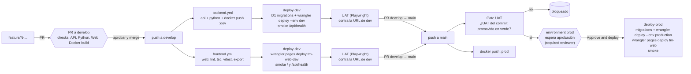

# Pipeline y ambientes (dev y prod)

Cómo llega un cambio de una rama `feature/*` a **dev** y luego a **prod**, qué secrets necesita, cómo se hace rollback y el guion de la demo. Issues: #27 (backend), #45 (frontend), #28 (UAT) y #29 (APM).

Todo corre en **Cloudflare, plan gratuito**:

| Pieza | dev | prod |
|---|---|---|
| Front (Next.js export estático) | Pages `tm-web-dev` (rama `develop`) | Pages `tm-web` (rama `main`) |
| API (Hono + D1) | Worker `tm-api-dev` (`wrangler --env dev`) | Worker `tm-api` (`wrangler --env production`) |
| Base de datos | D1 `tm-dev` | D1 `tm-prod` |
| Login | Cloudflare Access delante del dominio de Pages | igual |
| Imágenes del motor (Mac) | Docker Hub, tag `dev` | Docker Hub, tag `prod` |

Pages reenvía `/api/*` al Worker por el service binding `API`, así que el navegador ve un solo origen y la cookie de Access sirve para las dos cosas. La infraestructura (D1, proyectos de Pages, apps y service token de Access) se crea con Terraform en [`trading_maxxing-infra`](https://github.com/CarloSantoro21/trading_maxxing-infra).

## Flujo



## Workflows

| Workflow | Cuándo | Jobs |
|---|---|---|
| [`backend.yml`](../.github/workflows/backend.yml) | PR a `develop`/`main` (siempre); push a `develop`/`main` si cambió `apps/api`, `services`, `packages`, `pyproject.toml`, `uv.lock` o los reportes del laboratorio; manual | `API Worker (tsc + vitest + build)`, `Python (ruff + pytest)`, `Docker (agents/engine/forecast)`, `deploy-dev` + `UAT dev`, `Gate UAT` + `deploy-prod` |
| [`frontend.yml`](../.github/workflows/frontend.yml) | PR a `develop`/`main` (siempre); push a `develop`/`main` si cambió `apps/web`; manual | `Web (eslint + tsc + vitest)`, `deploy-dev` + `UAT dev`, `Gate UAT` + `deploy-prod` |
| [`uat.yml`](../.github/workflows/uat.yml) | Lo llaman los dos anteriores después de su deploy a dev; también manual | `UAT (Playwright)` |
| [`uat-gate.yml`](../.github/workflows/uat-gate.yml) | Lo llaman los dos anteriores en el push a `main` | `UAT de dev en verde` |
| [`cleanup-branches.yml`](../.github/workflows/cleanup-branches.yml) | Semanal / manual | Limpia ramas fusionadas |

Notas:

- **En cada PR corren todas las pruebas** (no hay filtro de rutas en `pull_request`). `Python (ruff + pytest)` y `Web (eslint + tsc + vitest)` son los checks requeridos por la protección de `develop`. Los filtros de rutas solo aplican al push, para no redesplegar lo que no cambió: en la demo, un cambio de UI dispara `frontend.yml` y uno de la API dispara `backend.yml`. Para forzar un deploy sin cambios: **Actions → Frontend/Backend → Run workflow** sobre `develop` o `main`.
- **Resultados de pruebas visibles en el run:** cada job de pruebas publica su JUnit como check propio (*Pruebas API (vitest)*, *Pruebas Python (pytest)*, *Pruebas Web (vitest)*, *Pruebas UAT (Playwright)*) y la tabla de **cobertura** en el *job summary*; los XML y HTML se suben como artifacts. Python exige 70 % de cobertura y la API 70 % de líneas (umbral en `apps/api/vitest.config.ts`).
- **APM (#29):** el job de la API verifica que `observability` (logs y traces) siga encendido en `wrangler.toml` para `dev` y `production` y lo deja en el summary. Las trazas se ven en Cloudflare → Workers & Pages → el Worker → *Observability*.
- **Imágenes del motor:** en PR solo se construyen (amd64, sin publicar). En push se construyen para `linux/amd64` y `linux/arm64` (la Mac es arm64) y se publican como `<DOCKERHUB_USERNAME>/trading-maxxing-{agents,engine,forecast}` con los tags `sha-<7 chars>` y `dev` (push a `develop`) o `prod` (push a `main`).
- **Sin secrets nada falla:** si faltan las credenciales de Cloudflare o Docker Hub, el job correspondiente termina en verde con un aviso *Deploy omitido* / *Docker Hub omitido* en el summary.
- El export del front se construye **una sola vez** por commit, con `NEXT_PUBLIC_ENV` (`dev`, `prod` o `pr`) y `NEXT_PUBLIC_COMMIT_SHA` (SHA corto), y ese mismo `out/` es el que se publica. `wrangler pages deploy` corre desde `apps/web`, así que también sube `apps/web/functions/` (la Pages Function que reenvía `/api/*` por el binding `API`).

### UAT y bloqueo de la promoción

1. Después de cada deploy a dev (front o API) corre el job **`UAT (Playwright)`** en el environment `dev`, contra `vars.WEB_URL`, con el service token de Access (`CF_ACCESS_CLIENT_ID` / `CF_ACCESS_CLIENT_SECRET`, que Playwright manda como headers `CF-Access-Client-Id` / `CF-Access-Client-Secret` con `extraHTTPHeaders`, en una config que el job genera en el runner y que extiende `apps/web/playwright.config.ts`). Sube el reporte HTML, las trazas y el JUnit como artifact **`playwright-report-uat`**.
2. Si la UAT falla, el run del push a `develop` queda en rojo y el check `… / UAT (Playwright)` de ese commit queda en *failure*.
3. Al hacer push a `main` (merge de `develop` → `main`), el job **`Gate UAT`** busca el commit de `develop` que se promovió (segundo padre del merge; si fue squash, la punta de `develop`) y lee ese check. Si está en rojo o sin terminar, **falla y `deploy-prod` no corre** (ni siquiera pide aprobación). Si no hay UAT registrada (por ejemplo, el cambio no tocó front ni API), deja pasar con un aviso.
4. Para desbloquear: arreglar en `develop` (nuevo PR), esperar la UAT en verde y volver a promover; o re-ejecutar la UAT fallida (*Re-run failed jobs*) si fue un falso positivo y luego *Re-run* del run de `main`.

## Environments de GitHub

| Environment | Ramas que pueden desplegar | Protección |
|---|---|---|
| `dev` | `develop` | Ninguna: deploy automático |
| `prod` | `main` | **Required reviewers:** `CarloSantoro21` (el run se pausa en *Waiting for review* hasta que alguien pulse *Approve and deploy*) |

Ya están creados. Para recrearlos (repo público, gratis):

```bash
export GH_TOKEN=$(gh auth token --user CarloSantoro21)
REPO=CarloSantoro21/trading_maxxing
USER_ID=$(gh api users/CarloSantoro21 --jq .id)

# dev: solo develop, sin aprobación
gh api -X PUT repos/$REPO/environments/dev --input - <<'JSON'
{"deployment_branch_policy":{"protected_branches":false,"custom_branch_policies":true}}
JSON
gh api -X POST repos/$REPO/environments/dev/deployment-branch-policies -f name=develop -f type=branch

# prod: solo main, con aprobación manual
gh api -X PUT repos/$REPO/environments/prod --input - <<JSON
{"wait_timer":0,"prevent_self_review":false,
 "reviewers":[{"type":"User","id":$USER_ID}],
 "deployment_branch_policy":{"protected_branches":false,"custom_branch_policies":true}}
JSON
gh api -X POST repos/$REPO/environments/prod/deployment-branch-policies -f name=main -f type=branch
```

## Secrets y variables

Equivalen a la *service connection* de la rúbrica. Los de Cloudflare y Docker Hub pueden ir a nivel repo (sirven a los dos environments) o por environment si se usan cuentas o tokens distintos.

| Nombre | Tipo | Dónde | De dónde sale |
|---|---|---|---|
| `CLOUDFLARE_API_TOKEN` | secret | repo (o cada environment) | Cloudflare → *My Profile → API Tokens*. Permisos: *Workers Scripts: Edit*, *D1: Edit*, *Cloudflare Pages: Edit*, *Account Settings: Read* |
| `CLOUDFLARE_ACCOUNT_ID` | secret | repo | Panel de Cloudflare (barra lateral de *Workers & Pages*) |
| `DOCKERHUB_USERNAME` | secret | repo | Usuario de Docker Hub |
| `DOCKERHUB_TOKEN` | secret | repo | Docker Hub → *Account settings → Personal access tokens* (Read & Write) |
| `CF_ACCESS_CLIENT_ID` | secret | `dev` y `prod` | Output `motor_service_token_client_id` del Terraform de infra |
| `CF_ACCESS_CLIENT_SECRET` | secret | `dev` y `prod` | Output `motor_service_token_client_secret` |
| `TM_SERVICE_TOKEN` | secret (opcional) | `dev` y `prod` | El mismo valor que usa el motor en `X-Service-Token`. Si existe, el deploy lo carga en el Worker como `SERVICE_TOKEN` |
| `API_URL` | variable | `dev` y `prod` | `https://tm-api-dev.<subdominio>.workers.dev` / `https://tm-api.<subdominio>.workers.dev` (si falta, se toma de la salida de `wrangler deploy`) |
| `WEB_URL` | variable | `dev` y `prod` | `https://tm-web-dev.pages.dev` / `https://tm-web.pages.dev` (o el dominio propio). La UAT corre contra la de `dev` |
| `PAGES_PROJECT` | variable (opcional) | `dev` y `prod` | Output `pages_project_name`; por omisión `tm-web-dev` y `tm-web` |
| `D1_DATABASE_ID` | variable (opcional) | `dev` y `prod` | Output `d1_database_id`; si existe, sustituye en el runner el `database_id` de `wrangler.toml` para ese ambiente |
| `ACCESS_TEAM_DOMAIN`, `ACCESS_AUD` | variables (opcionales) | `dev` y `prod` | Outputs `access_team_domain` y `access_web_aud`; se pasan a `wrangler deploy --var` (el Worker en la nube siempre se despliega con `AUTH_MODE=access`) |

Crearlos con `gh` (desde la carpeta del repo de infra para leer los outputs):

```bash
export GH_TOKEN=$(gh auth token --user CarloSantoro21)
REPO=CarloSantoro21/trading_maxxing

# Nivel repo
gh secret set CLOUDFLARE_API_TOKEN  --repo $REPO       # pega el token cuando lo pida
gh secret set CLOUDFLARE_ACCOUNT_ID --repo $REPO --body "<account id>"
gh secret set DOCKERHUB_USERNAME    --repo $REPO --body "<usuario>"
gh secret set DOCKERHUB_TOKEN       --repo $REPO

# Por environment (repite con --env prod y los valores de prod)
gh secret set CF_ACCESS_CLIENT_ID     --repo $REPO --env dev --body "$(terraform output -raw motor_service_token_client_id)"
gh secret set CF_ACCESS_CLIENT_SECRET --repo $REPO --env dev --body "$(terraform output -raw motor_service_token_client_secret)"
gh secret set TM_SERVICE_TOKEN        --repo $REPO --env dev
gh variable set API_URL        --repo $REPO --env dev --body "https://tm-api-dev.<subdominio>.workers.dev"
gh variable set WEB_URL        --repo $REPO --env dev --body "https://tm-web-dev.pages.dev"
gh variable set D1_DATABASE_ID --repo $REPO --env dev --body "$(terraform output -raw d1_database_id)"
gh variable set ACCESS_TEAM_DOMAIN --repo $REPO --env dev --body "$(terraform output -raw access_team_domain)"
gh variable set ACCESS_AUD         --repo $REPO --env dev --body "$(terraform output -raw access_web_aud)"
```

Para que el service token pase el login de Access en la URL de Pages (smoke y UAT), la aplicación de Access del front debe tener una política **Service Auth** que incluya ese token (lo define el Terraform de infra).

## Rollback

| Qué | Cómo |
|---|---|
| **API (Worker)** | `cd apps/api && pnpm exec wrangler deployments list --env production` y luego `pnpm exec wrangler rollback <version-id> --env production -m "rollback demo"` (sin id vuelve a la versión anterior). En el panel: Workers & Pages → `tm-api` → *Deployments* → *Rollback*. El *Version ID* de cada deploy queda en el summary del run. |
| **D1** | Las migraciones solo avanzan. Para deshacer una, se escribe otra migración que revierta el cambio y se despliega por el pipeline. Para recuperar datos: `wrangler d1 time-travel restore tm-prod --timestamp <ISO>` (Time Travel, 7 días en el plan gratuito). |
| **Front (Pages)** | Panel: Workers & Pages → `tm-web` → *Deployments* → en el deploy bueno, *⋯ → Rollback to this deployment*. Cada deploy tiene URL inmutable (`https://<hash>.tm-web.pages.dev`, queda en el summary) para comprobarlo antes. Alternativa por pipeline: *Actions → Frontend → Run workflow* sobre `main` después de revertir el commit. |
| **Por git** | `git revert <sha>` en una rama, PR a `develop` → dev → PR a `main` → aprobar prod. Es el camino "limpio": deja historia y pasa por la UAT. |
| **Motor (imágenes)** | En la Mac, fijar el tag anterior: `TM_ENV=sha-<7 chars>` en `.env.runner` y `make runner-up` (los tags `sha-*` nunca se sobrescriben). Para volver a mover `prod`: `docker buildx imagetools create -t <usuario>/trading-maxxing-engine:prod <usuario>/trading-maxxing-engine:sha-<anterior>`. |

## Guion de la demo (rúbrica: Pipeline, Ambientes, Cambio en dev, Post aprobar a producción, Cambio en producción)

Preparación: dos pestañas con `https://tm-web-dev.pages.dev` y `https://tm-web.pages.dev` (ya con login de Access), otra con *Actions* del repo. El header de la app muestra el ambiente y el SHA corto (`DEV · abc1234`).

1. **Cambio.** `git fetch origin && git checkout -b feature/demo-cambio origin/develop`. Cambiar un texto visible (por ejemplo el subtítulo del dashboard en `apps/web/src/...`). `git add <archivo> && git commit -m "feat(web): texto de la demo" && git push -u origin feature/demo-cambio`.
2. **PR.** `gh pr create --base develop --fill`. Enseñar los checks: *Web (eslint + tsc + vitest)*, *Python (ruff + pytest)*, *API Worker*, las imágenes Docker y, en la pestaña **Checks**, *Pruebas Web (vitest)* con los resultados y el summary con la cobertura.
3. **Aprobar y merge a develop.** Approve en el PR → *Merge*. Se dispara **Frontend** en `develop`.
4. **Dev.** En Actions: `web` → `Deploy web a dev` (environment `dev`, sin aprobación) → smoke → `UAT dev / UAT (Playwright)`. Abrir el summary: URL de dev, smoke de `/` y `/api/health`, y el artifact `playwright-report-uat`.
5. **Pruebas.** Mostrar los checks de JUnit (vitest y UAT) y la tabla de cobertura del summary; para el backend, el run de **Backend** con *Pruebas API (vitest)*, *Pruebas Python (pytest)* y la cobertura.
6. **URL dev.** Recargar `https://tm-web-dev.pages.dev`: aparece el cambio y el SHA nuevo con `DEV`. Prod sigue igual.
7. **Promover.** `gh pr create --base main --head develop --title "release: demo"` → merge (merge commit). Se dispara Frontend en `main`: `web` → **Gate UAT** (verde) → `Deploy web a prod` queda en **Waiting for review**.
8. **Aprobar prod.** *Review deployments* → marcar `prod` → **Approve and deploy**. Termina el deploy y el smoke.
9. **URL prod.** Recargar `https://tm-web.pages.dev`: aparece el cambio con `PROD` y el mismo SHA. En *Environments* del repo se ve el historial de deploys de `dev` y `prod`.
10. (Opcional) **Rollback** en vivo desde el panel de Pages, o `wrangler rollback --env production` para la API.

Para el cambio de backend la secuencia es igual, tocando `apps/api` (por ejemplo, el campo `version` de `/api/health`), y el run es **Backend** (migraciones D1 + `wrangler deploy` + smoke de `/api/health`).
