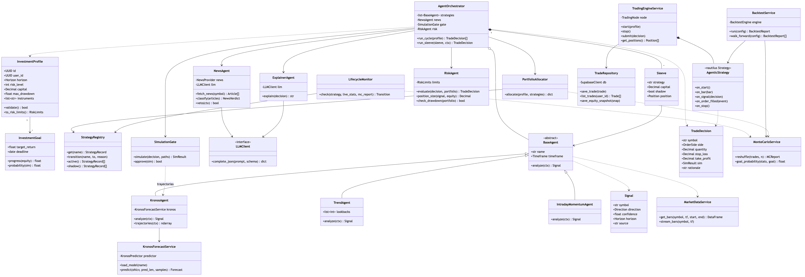
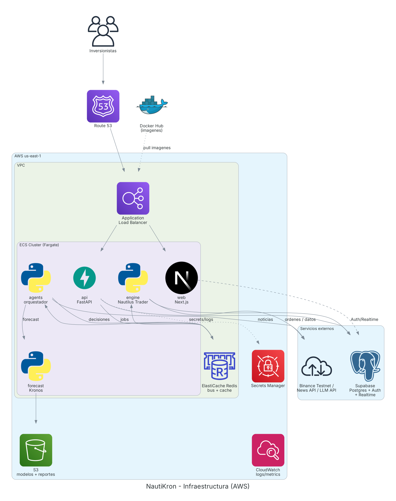
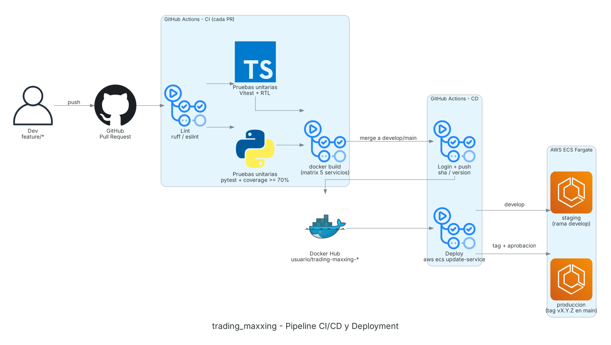
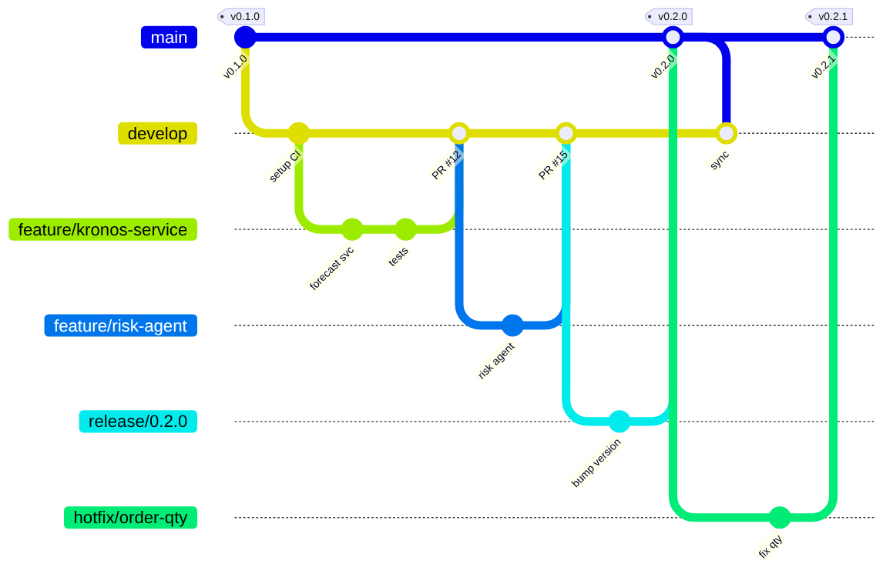

# trading_maxxing — Propuesta de proyecto final

Infraestructura para el Desarrollo Continuo · ITESO · Otoño 2026

Repositorio: https://github.com/CarloSantoro21/trading_maxxing

Project Board: https://github.com/users/CarloSantoro21/projects/2

Versión 2 (7 de noviembre de 2026). Cambios contra la versión 1: se agregan una biblioteca de estrategias con evidencia publicada en cripto, una fase de validación (backtest in-sample y out-of-sample, y Monte Carlo) y una simulación antes de cada operación. La infraestructura se define con Terraform y se ajusta el calendario.

## 1. Título

trading_maxxing: plataforma multiestrategia de trading de criptomonedas. Un comité de agentes combina pronósticos de series de tiempo (Kronos) con estrategias cuantitativas validadas, simula cada operación antes de ejecutarla y opera sobre un motor event-driven (NautilusTrader).

## 2. Descripción del proyecto

En trading_maxxing el usuario define su perfil de inversión: capital, horizonte (corto, mediano o largo plazo), nivel de riesgo del 1 al 5, drawdown máximo, instrumentos y metas. Con ese perfil, un comité de agentes analiza el mercado en cada vela y propone y ejecuta operaciones de forma controlada.

Problema. Un inversionista individual no puede vigilar el mercado todo el día. Además, la mayoría de los bots y las estrategias que circulan en redes nunca se validan fuera de los datos con los que se diseñaron, así que el usuario no sabe si tienen ventaja real o si fue suerte.

Solución. Un sistema que:

1. Mantiene una biblioteca de estrategias intercambiables. Todas cumplen el mismo contrato (`analyze(ctx) -> Signal`) y solo se incluyen las que tienen evidencia publicada en criptomonedas, además de Kronos.
2. Valida cada estrategia antes de dejarla operar: backtest in-sample, prueba out-of-sample y Monte Carlo sobre la secuencia de operaciones. Solo las que pasan criterios fijos reciben capital.
3. Combina las señales según el horizonte del perfil y los pesos ganados en la validación.
4. Simula cada operación antes de ejecutarla con dos fuentes: las trayectorias que genera Kronos y trayectorias históricas reconstruidas por bootstrap. Si el valor esperado no es positivo, la bloquea.
5. Controla el riesgo con reglas deterministas: tamaño de posición, stop-loss y take-profit, drawdown máximo y botón de paro.
6. Ejecuta sobre NautilusTrader en Binance Spot Testnet y muestra en un dashboard el portafolio, el P&L, la justificación de cada operación y la probabilidad de alcanzar la meta.

Alcance del MVP. Solo criptomonedas: BTC/USDT y ETH/USDT en Binance Spot Testnet, es decir, paper trading sin dinero real. Incluye backtesting con datos históricos, 3 horizontes y 5 niveles de riesgo. Queda fuera del alcance operar con dinero real, acciones o forex, y entrenar modelos propios (solo inferencia).

### 2.1 Biblioteca de estrategias

Una estrategia entra a la biblioteca solo si tiene evidencia publicada en criptomonedas. Aun así, debe pasar nuestra validación (sección 3.2, fase 1) antes de operar.

| Estrategia | Agente | Evidencia | Timeframe |
|---|---|---|---|
| Pronóstico con Kronos | KronosAgent | Shi et al., *Kronos: A Foundation Model for the Language of Financial Markets*, AAAI 2026. En zero-shot, su RankIC de precio es ~93 % mayor que el del mejor modelo base | 15 min |
| Trend following (canales Donchian en varios periodos) | TrendAgent | Liu, Tsyvinski y Goldstein, *Risks and Returns of Cryptocurrency*, Review of Financial Studies, 2021 (momentum de serie de tiempo en BTC, ETH y XRP). Zarattini, Pagani y Barbon, *Catching Crypto Trends*, SFI 25-80, 2025 | 1 día |
| Momentum intradía | IntradayMomentumAgent | Shen, Urquhart y Wang, *Bitcoin intraday time-series momentum*, Financial Review, 2022: el retorno de la primera media hora predice el de la última, in-sample y out-of-sample | 30 min |

Se evaluaron y descartaron Noise Band (solo tiene evidencia en SPY), la ruptura de la caja asiática (forex, con ventaja marginal) y el Initial Balance en tercios (no encontramos estudios). Las noticias no son una estrategia: el NewsAgent solo puede vetar entradas.

### 2.2 Código que vamos a reutilizar

NautilusTrader (https://github.com/nautechsystems/nautilus_trader, licencia LGPL-3.0)

- Qué aporta: un motor event-driven con núcleo en Rust que se controla desde Python. Incluye TradingNode para operar en vivo, BacktestEngine, la clase base Strategy, un RiskEngine, cache, message bus con Redis opcional y adaptadores para Binance, entre otros.
- Cómo lo usamos: como dependencia con versión fija. Escribimos AgenticStrategy, que hereda de Strategy, recibe las decisiones del orquestador y las convierte en órdenes bracket. Usamos el adaptador de Binance en modo testnet y BacktestEngine para el laboratorio de validación. El mismo código corre en backtest y en vivo.
- Licencia: la LGPL permite usarlo como librería sin modificar su código.

Kronos (https://github.com/shiyu-coder/Kronos, licencia MIT)

- Qué aporta: un modelo fundacional para velas financieras. Se usa con KronosTokenizer, Kronos y KronosPredictor, cuyos métodos predict() y predict_batch() reciben un DataFrame OHLCV. Es generativo: con `sample_count` devuelve varias trayectorias posibles del precio.
- Cómo lo usamos: lo envolvemos en un microservicio FastAPI (forecast). Usamos Kronos-small (24.7M parámetros, corre en CPU, contexto de 512 velas). El KronosAgent convierte las trayectorias en dirección, confianza y probabilidades de tocar el stop o el objetivo, que alimentan la simulación previa a cada operación.

Por qué encajan. NautilusTrader resuelve la parte crítica (ejecución, órdenes, riesgo y backtest determinista), pero no incluye interfaz, orquestación ni IA. Kronos aporta el pronóstico, pero su señal por sí sola es débil y no ejecuta operaciones. trading_maxxing construye lo que falta: la biblioteca de estrategias, la validación, la simulación, la configuración por perfil, la interfaz y la infraestructura.

## 3. Componentes y métodos

| Componente | Responsabilidad | Motor | Métodos principales |
|---|---|---|---|
| web (Next.js) | Onboarding, perfil, dashboard, backtests | — | /onboarding, /dashboard, /strategies, /backtests, /trades |
| api (FastAPI) | API REST, validación, disparo de jobs | — | POST /profiles, GET /portfolio, POST /backtests, POST /bots/{id}/start, POST /bots/{id}/stop, GET /trades |
| InvestmentProfile | Preferencias del usuario | Python | validate(), to_risk_limits() |
| InvestmentGoal | Metas de rendimiento | Python | progress(equity), probability(sim) |
| BaseAgent (abstracta) | Contrato común de las estrategias | — | analyze(ctx) -> Signal |
| KronosAgent | Señal y trayectorias a partir de Kronos | Kronos-small | analyze(ctx), trajectories(ctx) |
| TrendAgent | Trend following con canales Donchian | Python | analyze(ctx) |
| IntradayMomentumAgent | Momentum de la primera a la última media hora | Python | analyze(ctx) |
| NewsAgent | Veto ante noticias de alto impacto | LLM (Groq) | fetch_news(symbol), classify(articles), veto(ctx) |
| AgentOrchestrator | Ciclo de decisión por vela | Python | run_cycle(profile), collect_signals(ctx), aggregate(signals) |
| PortfolioAllocator | Pesos por estrategia (validación y horizonte) | Python | weights(profile, stats) |
| SimulationGate | Monte Carlo antes de cada operación | numpy | simulate(decision, paths) -> SimResult, approve(sim) |
| RiskAgent | Tamaño de posición y límites | Python | evaluate(decision, portfolio), position_size(signal, equity), check_drawdown(portfolio) |
| ExplainerAgent | Justificación en lenguaje natural (fuera del camino de la decisión) | LLM | explain(decision) -> str |
| LLMClient | Interfaz común para proveedores de LLM | Groq | complete_json(prompt, schema) |
| KronosForecastService | Inferencia de Kronos | Kronos | load_model(name), predict(ohlcv, pred_len, samples) |
| MarketDataService | Velas históricas y en tiempo real | Python | get_bars(symbol, tf, start, end), stream_bars(symbol, tf) |
| TradingEngineService | Envuelve el TradingNode de Nautilus | Nautilus | start(profile), stop(), submit(decision), get_positions() |
| AgenticStrategy (Strategy de Nautilus) | Convierte decisiones en órdenes | Nautilus | on_start(), on_bar(bar), on_signal(decision), on_order_filled(event), on_stop() |
| BacktestService | Backtests in-sample y out-of-sample | Nautilus | run(config) -> BacktestReport, walk_forward(config) |
| MonteCarloService | Remuestreo de operaciones y proyección de metas | numpy | reshuffle(trades, n), goal_probability(stats, goal) |
| TradeRepository | Persistencia en Supabase | Python | save_trade(trade), list_trades(user_id), save_equity_snapshot(snap) |

Solo el NewsAgent y el ExplainerAgent usan un LLM. Las estrategias, el orquestador, la simulación y el riesgo son deterministas por tres razones:

- Los backtests tienen que ser reproducibles.
- Un LLM conoce precios históricos, lo que contaminaría el backtest con información del futuro.
- El control de riesgo no puede depender de un modelo probabilístico.

LLMClient permite cambiar de proveedor por configuración; por ejemplo, para comparar Groq con modelos de decisión como Jev.

### 3.1 Diagrama de clases

El código fuente del diagrama está en [classes.mmd](classes.mmd).

### 3.2 Flujo de una operación

Fase 1, laboratorio (antes de que una estrategia opere):

1. MarketDataService descarga la historia de BTC/USDT y ETH/USDT de Binance.
2. BacktestService corre la estrategia en el periodo in-sample (2020–2023) con comisiones y slippage. Aquí se ajustan sus parámetros.
3. Con los parámetros congelados, se prueba en el periodo out-of-sample (2024–2025).
4. MonteCarloService reordena las operaciones 10,000 veces y obtiene la distribución del drawdown máximo y la probabilidad de ruina.
5. La estrategia se aprueba solo si cumple criterios fijos: Sharpe out-of-sample mayor a 0.5, drawdown del percentil 95 por debajo del límite y al menos 100 operaciones. Al aprobarse, recibe un peso en el PortfolioAllocator.

Fase 2, producción (en cada cierre de vela):

1. El orquestador arma el contexto: velas recientes, portafolio y perfil.
2. KronosAgent, TrendAgent e IntradayMomentumAgent emiten sus señales en paralelo.
3. NewsAgent clasifica las noticias recientes y puede vetar nuevas entradas.
4. AgentOrchestrator y PortfolioAllocator ponderan las señales según el horizonte y los pesos validados.
5. SimulationGate calcula, con los SL y TP propuestos, la probabilidad de llegar al objetivo antes que al stop. Usa las 100 trayectorias de Kronos y 10,000 trayectorias históricas reconstruidas por bootstrap. Si el valor esperado no es positivo, bloquea la operación.
6. RiskAgent calcula el tamaño de la posición, fija SL y TP, revisa los límites y responde PASS o BLOCK con la razón.
7. La decisión se publica en Redis. AgenticStrategy envía una orden bracket a Binance Testnet.
8. La operación se guarda en Supabase, el ExplainerAgent redacta la justificación y el dashboard se actualiza con Supabase Realtime.
9. Mientras la posición está abierta, el SL y el TP la cierran automáticamente. Si se rebasa el drawdown máximo, el kill switch cierra todo y detiene el bot.

Monte Carlo se usa en tres puntos: en el laboratorio (remuestreo de operaciones), antes de cada operación (SimulationGate) y en el dashboard (probabilidad de alcanzar la meta).

## 4. Stack tecnológico

- Frontend: Next.js 15 (App Router), TypeScript, Tailwind, shadcn/ui y Recharts.
- Backend: FastAPI con Pydantic sobre Python 3.12.
- Estrategias y agentes: worker en Python 3.12 con numpy y pandas. LLM vía Groq (gpt-oss-20b) detrás de una interfaz LLMClient, y noticias de CryptoPanic.
- Pronóstico: Kronos-small con PyTorch en CPU, servido con FastAPI.
- Motor de trading: NautilusTrader.
- Base de datos y autenticación: Supabase (Postgres, Auth, Realtime y Row Level Security).
- Mensajería y cache: Redis (ElastiCache en la nube, contenedor en local).
- Contenedores: Docker y Docker Compose, con las imágenes publicadas en Docker Hub.
- Infraestructura como código: Terraform, con el estado en S3 y bloqueo con DynamoDB.
- CI/CD: GitHub Actions, con autenticación a AWS por OIDC (sin llaves de larga duración).
- Nube: AWS (ECS Fargate, Application Load Balancer, ElastiCache, Secrets Manager, CloudWatch y S3).
- Calidad: pytest y pytest-cov, Vitest y React Testing Library, ruff, ESLint y Prettier.

Por qué ECS Fargate y no Kubernetes. Son 5 servicios sin requisitos de orquestación avanzada. EKS cobra el plano de control (~73 USD al mes) y agrega mucha complejidad operativa; Fargate cubre lo que necesitamos con menos costo y menos piezas.

Por qué Terraform. Toda la infraestructura queda versionada y revisada por pull request. El CI corre `terraform plan` en cada PR que toca `infra/`, y staging se puede destruir y recrear para ahorrar costos.

## 5. Recursos que se van a crear

| Recurso | Tipo | Propósito |
|---|---|---|
| trading-maxxing-vpc | VPC con 2 subredes públicas y 2 privadas | Aislamiento de red |
| trading-maxxing-alb | Application Load Balancer | Enruta / a web y /api a api |
| trading-maxxing-cluster | ECS Cluster (Fargate) | Ejecuta los contenedores |
| web, api, agents, forecast, engine | 5 servicios de ECS | Un servicio por contenedor |
| trading-maxxing-redis | ElastiCache Redis | Canal de decisiones y cola de jobs |
| trading-maxxing/* | Secrets Manager | Claves de Binance Testnet, Supabase, Groq y la API de noticias |
| /ecs/trading-maxxing | CloudWatch Logs y alarmas | Logs, métricas y alerta de drawdown |
| trading-maxxing-artifacts | S3 | Pesos del modelo, reportes de backtest y datos históricos |
| trading-maxxing-tfstate | S3 y DynamoDB | Estado y bloqueo de Terraform |
| github-actions-deploy | Rol IAM con OIDC | Deploy desde GitHub Actions sin llaves |
| Proyecto de Supabase | SaaS | Postgres, Auth y Realtime |
| trading-maxxing-web, -api, -agents, -forecast, -engine | Repositorios en Docker Hub | Imágenes versionadas |

Todo lo de AWS se define en `infra/` con Terraform, con un módulo por recurso y un entorno por carpeta (`infra/envs/staging` e `infra/envs/prod`). En local, docker-compose.yml levanta los 5 servicios y Redis, conectados a un proyecto de Supabase de desarrollo.

### 5.1 Diagrama de deployment

El pipeline corre en GitHub Actions:

- En cada pull request a develop o main: lint (ruff y ESLint), pruebas de Python con pytest (cobertura mínima de 70 %) y pruebas del frontend con Vitest en paralelo, y build de las 5 imágenes sin publicarlas. Si el PR toca `infra/`, también corre `terraform fmt`, `validate` y `plan`.
- Al hacer merge a develop: lo anterior, más el push de las imágenes a Docker Hub con los tags develop y `sha-<commit>`, y deploy automático a staging.
- Al crear un tag vX.Y.Z en main: push a Docker Hub con los tags X.Y.Z y latest, y deploy a producción con aprobación manual mediante GitHub Environments.

#### Pruebas unitarias

- Estrategias (TrendAgent, IntradayMomentumAgent): señales correctas sobre series sintéticas con resultado conocido (pytest).
- KronosAgent y KronosForecastService: conversión de trayectorias a señal y contrato de /predict con un predictor simulado, para no descargar el modelo en CI (pytest y unittest.mock).
- SimulationGate y MonteCarloService: probabilidades sobre casos analíticos con solución conocida y semilla fija (pytest).
- RiskAgent: tamaño de posición por nivel de riesgo, stop-loss y take-profit, y bloqueo por drawdown (pytest).
- AgentOrchestrator y PortfolioAllocator: agregación, pesos por horizonte y señales contradictorias (pytest con mocks).
- NewsAgent: clasificación con un LLM simulado (pytest y respx).
- AgenticStrategy y BacktestService: órdenes correctas y reporte reproducible con BacktestEngine y datos de prueba (pytest y Nautilus).
- API: validación de perfiles, endpoints y autenticación (pytest y TestClient).
- Web: formulario de perfil y componentes del dashboard (Vitest y React Testing Library).

Ningún pull request se fusiona con pruebas fallidas o con cobertura de Python menor a 70 %.

#### Docker Hub

- Una imagen por servicio: trading-maxxing-web, trading-maxxing-api, trading-maxxing-agents, trading-maxxing-forecast y trading-maxxing-engine.
- Tags: `sha-<commit>` para trazabilidad, develop para staging, y X.Y.Z y latest para producción.
- Builds multi-stage. La imagen engine parte de la imagen oficial de NautilusTrader y la imagen forecast descarga los pesos de Kronos durante el build para arrancar rápido.
- Las credenciales viven en GitHub Secrets (DOCKERHUB_USERNAME y DOCKERHUB_TOKEN).

### 5.2 Estrategia de ramas

Usamos Git Flow simplificado:

- main: código en producción. Protegida; solo recibe merges de `release/*` y `hotfix/*`, y cada merge lleva un tag vX.Y.Z.
- develop: rama de integración, desplegada en staging. Protegida; requiere pull request y CI en verde.
- `feature/<issue>-<descripcion>`: nuevas funcionalidades, por ejemplo feature/18-risk-agent. Sale de develop y regresa por pull request con squash merge.
- release/X.Y.Z: estabilización antes de liberar. Sale de develop y solo admite correcciones.
- `hotfix/<descripcion>`: correcciones urgentes en producción. Sale de main y se fusiona en main y develop.

Los commits siguen Conventional Commits (feat:, fix:, test:, ci:, docs:), cada pull request enlaza su issue (Closes #18) y las versiones siguen versionado semántico.

## 6. Plan de trabajo

El plan está en el GitHub Project Board del repositorio (https://github.com/users/CarloSantoro21/projects/2), con columnas Backlog, To Do, In Progress, In Review y Done. Cada issue tiene descripción, criterios de aceptación, etiquetas por área (frontend, backend, agents, ml, trading-engine, devops, testing, docs, database) y milestone. El calendario se ajustó en la versión 2:

- M1, Fundaciones e infraestructura (hasta el 11 de noviembre): ramas protegidas, estructura del monorepo, Docker Compose, CI básico, Supabase y Wiki.
- M2, Motor, pronóstico y estrategias (hasta el 18 de noviembre): datos de mercado, servicio de Kronos, integración con Nautilus, TrendAgent, IntradayMomentumAgent y laboratorio de backtest con Monte Carlo.
- M3, Agentes, simulación y API (hasta el 24 de noviembre): KronosAgent, NewsAgent, SimulationGate, RiskAgent, orquestador, PortfolioAllocator y API REST.
- M4, Frontend y deployment (hasta el 1 de diciembre): dashboard, onboarding, backtests en la interfaz, Terraform y CD a AWS con Docker Hub.
- M5, Cierre (hasta el 6 de diciembre): pruebas end-to-end, monitoreo, documentación y demo final.

Issues: https://github.com/CarloSantoro21/trading_maxxing/issues

## 7. Riesgos y mitigaciones

- La API de NautilusTrader v2 puede cambiar entre versiones: fijamos la versión exacta y la imagen base por digest.
- Kronos puede ser lento en CPU, sobre todo con 100 trayectorias: usamos Kronos-small, predict_batch, cache de pronósticos por vela y, si hace falta, menos trayectorias.
- Sobreajuste de estrategias: separación estricta entre in-sample y out-of-sample, parámetros congelados antes de la prueba y criterios de aprobación fijados de antemano.
- Señales malas pueden generar pérdidas: operamos solo en testnet, la SimulationGate bloquea operaciones con valor esperado negativo y el RiskAgent aplica el drawdown máximo y un botón de paro.
- Costos de AWS: tareas de Fargate mínimas, staging destruido con `terraform destroy` fuera de horario y uso del Free Tier.
- Límites de las APIs de noticias y del LLM: cache en Redis, llamadas solo al cierre de vela y una interfaz LLMClient para cambiar de proveedor.
- Calendario ajustado: las estrategias deterministas se implementan antes que las dependientes de modelos, y el ExplainerAgent y la proyección de metas son opcionales si falta tiempo.

trading_maxxing es un proyecto académico. Opera solo en entornos de prueba y no constituye asesoría financiera.
