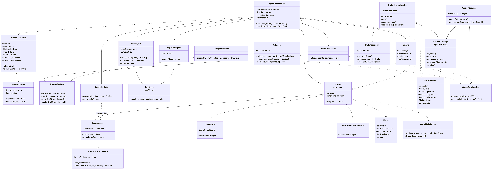
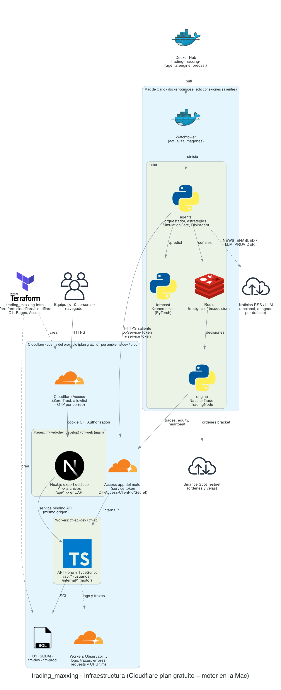
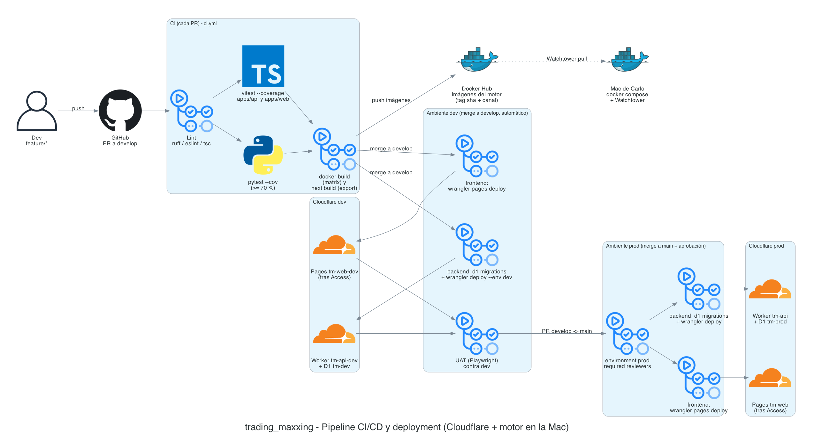
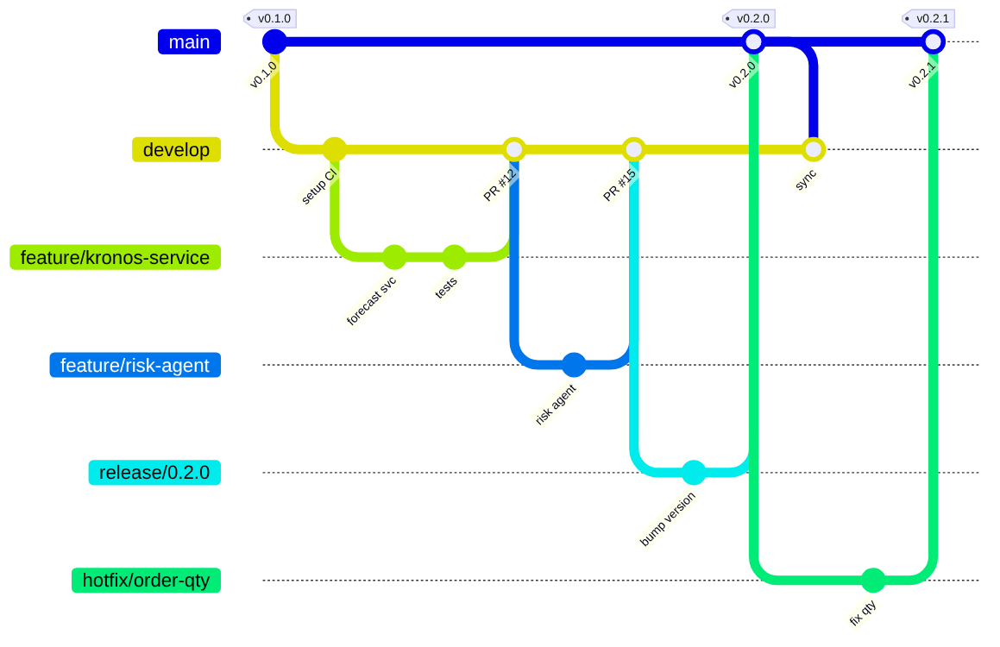

# trading_maxxing — Propuesta de proyecto final

Infraestructura para el Desarrollo Continuo · ITESO · Otoño 2026

Repositorio: https://github.com/CarloSantoro21/trading_maxxing

Project Board: https://github.com/users/CarloSantoro21/projects/2

Versión 2 (7 de noviembre de 2026). Cambios contra la versión 1: se agregan una biblioteca de estrategias con evidencia publicada en cripto, una fase de validación (backtest in-sample y out-of-sample, y Monte Carlo) y una simulación antes de cada operación. La infraestructura se define con Terraform y se ajusta el calendario.

## 1. Título

trading_maxxing: plataforma multiestrategia de trading de criptomonedas. Un comité de agentes combina pronósticos de series de tiempo (Kronos) con estrategias cuantitativas validadas, simula cada operación antes de ejecutarla y opera sobre un motor event-driven (NautilusTrader).

## 2. Descripción del proyecto

En trading_maxxing cada usuario (el autor y un equipo de menos de 10 personas) tiene su propio portafolio y solo decide tres cosas: su capital, su nivel de riesgo del 1 al 5 y sus metas. Todo lo demás es compartido: el laboratorio, las estrategias, sus señales y su ciclo de vida se calculan una sola vez para todos, y cada portafolio las ejecuta en la proporción que corresponde a su nivel de riesgo.

Problema. Un inversionista individual no puede vigilar el mercado todo el día. Además, la mayoría de los bots y las estrategias que circulan en redes nunca se validan fuera de los datos con los que se diseñaron, así que el usuario no sabe si tienen ventaja real o si fue suerte.

Solución. Un sistema que:

1. Mantiene una biblioteca de estrategias intercambiables. Todas cumplen el mismo contrato (`analyze(ctx) -> Signal`) y solo se incluyen las que tienen evidencia publicada en criptomonedas, además de Kronos.
2. Valida cada estrategia antes de dejarla operar: backtest in-sample, prueba out-of-sample y Monte Carlo sobre la secuencia de operaciones. Solo las que pasan criterios fijos reciben capital.
3. Asigna a cada estrategia su propio bolsillo de capital (sleeve) dentro de cada portafolio, según los resultados de su validación. El nivel de riesgo del usuario decide qué fracción de cada sleeve se invierte y cuánto queda en USDT.
4. Simula cada operación antes de ejecutarla con trayectorias históricas reconstruidas por bootstrap; en el sleeve de Kronos se suman las trayectorias que genera el propio modelo. Si el valor esperado no es positivo, la bloquea.
5. Controla el riesgo con reglas deterministas: tamaño de posición, stop-loss y take-profit, drawdown máximo y botón de paro.
6. Ejecuta sobre NautilusTrader en Binance Spot Testnet y muestra en un dashboard el portafolio, el P&L, la justificación de cada operación y la probabilidad de alcanzar la meta.

Alcance del MVP. Solo criptomonedas: BTC/USDT y ETH/USDT en Binance Spot Testnet, es decir, paper trading sin dinero real. Al ser spot, solo se puede estar comprado o en USDT: una señal `long` significa comprar o mantener, y `flat` significa vender y quedarse en USDT. Los cortos no se abren. Incluye backtesting con datos históricos, 3 horizontes y 5 niveles de riesgo. Queda fuera del alcance operar con dinero real, acciones o forex, y entrenar modelos propios (solo inferencia).

### 2.1 Biblioteca de estrategias

Una estrategia entra a la biblioteca solo si tiene evidencia publicada en criptomonedas. Aun así, debe pasar nuestra validación (sección 3.2, fase 1) antes de operar.

| Estrategia | Agente | Evidencia | Timeframe |
|---|---|---|---|
| Pronóstico con Kronos | KronosAgent | Shi et al., *Kronos: A Foundation Model for the Language of Financial Markets*, AAAI 2026. En zero-shot, su RankIC de precio es ~93 % mayor que el del mejor modelo base. Sus datos de preentrenamiento llegan a junio de 2024 (apéndice D del paper) | 4 h |
| Trend following (canales Donchian en varios periodos) | TrendAgent | Liu y Tsyvinski, *Risks and Returns of Cryptocurrency*, Review of Financial Studies, 2021 (momentum de serie de tiempo en BTC, ETH y XRP). Zarattini, Pagani y Barbon, *Catching Crypto Trends*, SFI 25-80, 2025 | 1 día |
| Momentum intradía | IntradayMomentumAgent | Shen, Urquhart y Wang, *Bitcoin intraday time-series momentum*, Financial Review, 2022: el retorno de la primera media hora predice el de la última, in-sample y out-of-sample | 30 min |

Se evaluaron y descartaron Noise Band (solo tiene evidencia en SPY), la ruptura de la caja asiática (forex, con ventaja marginal) y el Initial Balance en tercios (no encontramos estudios). Las noticias no son una estrategia: el NewsAgent solo puede vetar entradas.

### 2.2 Código que vamos a reutilizar

NautilusTrader (https://github.com/nautechsystems/nautilus_trader, licencia LGPL-3.0)

- Qué aporta: un motor event-driven con núcleo en Rust que se controla desde Python. Incluye TradingNode para operar en vivo, BacktestEngine, la clase base Strategy, un RiskEngine, cache, message bus con Redis opcional y adaptadores para Binance, entre otros.
- Cómo lo usamos: como dependencia con versión fija. Escribimos AgenticStrategy, que hereda de Strategy, recibe las decisiones del orquestador y las convierte en órdenes bracket. Usamos el adaptador de Binance en modo testnet y BacktestEngine para el laboratorio de validación. El mismo código corre en backtest y en vivo.
- Licencia: la LGPL permite usarlo como librería sin modificar su código.

Kronos (https://github.com/shiyu-coder/Kronos, licencia MIT)

- Qué aporta: un modelo fundacional para velas financieras. Se usa con KronosTokenizer, Kronos y KronosPredictor, cuyos métodos predict() y predict_batch() reciben un DataFrame OHLCV. Es generativo: con `sample_count` devuelve varias trayectorias posibles del precio.
- Cómo lo usamos: lo envolvemos en un microservicio FastAPI (forecast). Usamos Kronos-small (24.7M parámetros, contexto de 512 velas) sobre velas de 4 horas, con unas 20 trayectorias por decisión. Medido en una Mac M5, cada trayectoria tarda unos 0.6 s con aceleración Metal (MPS) y 1.1 s en CPU, porque la implementación no tiene caché de KV; por eso el sleeve de Kronos decide cada 4 horas y sus pronósticos del backtest se precalculan una vez y se guardan en Parquet. El KronosAgent convierte las trayectorias en dirección, confianza y probabilidades de tocar el stop o el objetivo.

Por qué encajan. NautilusTrader resuelve la parte crítica (ejecución, órdenes, riesgo y backtest determinista), pero no incluye interfaz, orquestación ni IA. Kronos aporta el pronóstico, pero su señal por sí sola es débil y no ejecuta operaciones. trading_maxxing construye lo que falta: la biblioteca de estrategias, la validación, la simulación, la configuración por perfil, la interfaz y la infraestructura.

## 3. Componentes y métodos

| Componente | Responsabilidad | Motor | Métodos principales |
|---|---|---|---|
| web (Next.js) | Onboarding, perfil, dashboard, backtests | — | /onboarding, /dashboard, /strategies, /backtests, /trades |
| api (FastAPI) | API REST, validación, disparo de jobs | — | POST /profiles, GET /portfolio, POST /backtests, POST /bots/{id}/start, POST /bots/{id}/stop, GET /trades |
| InvestmentProfile | Capital, nivel de riesgo (1 a 5) y metas del usuario | Python | validate(), to_risk_limits() |
| InvestmentGoal | Metas de rendimiento | Python | progress(equity), probability(sim) |
| BaseAgent (abstracta) | Contrato común de las estrategias | — | analyze(ctx) -> Signal |
| KronosAgent | Señal y trayectorias a partir de Kronos | Kronos-small | analyze(ctx), trajectories(ctx) |
| TrendAgent | Trend following con canales Donchian | Python | analyze(ctx) |
| IntradayMomentumAgent | Momentum de la primera a la última media hora | Python | analyze(ctx) |
| NewsAgent | Veto ante noticias de alto impacto | LLM (Groq) | fetch_news(symbol), classify(articles), veto(ctx) |
| AgentOrchestrator | Ciclo por vela: corre cada sleeve activo y en shadow | Python | run_cycle(profile), run_sleeve(sleeve, ctx) |
| PortfolioAllocator | Pesos globales por estrategia (validación y correlación) y exposición por usuario según su nivel de riesgo | Python | weights(strategies), allocate(profile, weights) -> dict[str, Decimal] |
| StrategyRegistry | Estado del ciclo de vida de cada estrategia (tabla `strategies`) | Python + Supabase | get(name), transition(name, to, reason), active(), shadow() |
| LifecycleMonitor | Detecta deterioro en vivo y degrada estrategias | Python | check(strategy, live_stats, mc_report) -> Transition |
| SimulationGate | Monte Carlo antes de cada operación | numpy | simulate(decision, paths) -> SimResult, approve(sim) |
| RiskAgent | Tamaño de posición y límites | Python | evaluate(decision, portfolio), position_size(signal, equity), check_drawdown(portfolio) |
| ExplainerAgent | Justificación en lenguaje natural (fuera del camino de la decisión) | LLM | explain(decision) -> str |
| LLMClient | Interfaz común para proveedores de LLM | Groq | complete_json(prompt, schema) |
| KronosForecastService | Inferencia de Kronos | Kronos | load_model(name), predict(ohlcv, pred_len, samples) |
| MarketDataService | Velas históricas y en tiempo real | Python | get_bars(symbol, tf, start, end), stream_bars(symbol, tf) |
| TradingEngineService | Envuelve el TradingNode de Nautilus | Nautilus | start(profile), stop(), submit(decision), get_positions() |
| AgenticStrategy (Strategy de Nautilus) | Convierte decisiones en órdenes | Nautilus | on_start(), on_bar(bar), on_signal(decision), on_order_filled(event), on_stop() |
| BacktestService | Backtests in-sample y out-of-sample | Nautilus | run(config) -> BacktestReport, walk_forward(config) |
| MonteCarloService | Remuestreo de operaciones y proyección de metas | numpy | reshuffle(trades, n), goal_probability(stats, goal) |
| TradeRepository | Persistencia en Supabase | Python | save_trade(trade), list_trades(user_id), save_equity_snapshot(snap) |

Solo el NewsAgent y el ExplainerAgent usan un LLM. Las estrategias, el orquestador, la simulación y el riesgo son deterministas por tres razones:

- Los backtests tienen que ser reproducibles.
- Un LLM conoce precios históricos, lo que contaminaría el backtest con información del futuro.
- El control de riesgo no puede depender de un modelo probabilístico.

LLMClient permite cambiar de proveedor por configuración; por ejemplo, para comparar Groq con modelos de decisión como Jev.

### 3.1 Diagrama de clases



El código fuente del diagrama está en [classes.mmd](classes.mmd).

### 3.2 Flujo de una operación

Fase 1, laboratorio (antes de que una estrategia opere):

1. MarketDataService descarga la historia de BTC/USDT y ETH/USDT de Binance.
2. BacktestService corre un walk-forward con comisiones y slippage: optimiza en 12 meses (in-sample), prueba en los 3 siguientes (out-of-sample) y avanza 3 meses, con datos desde 2020 y 20 tramos de prueba de 2021-T1 a 2025-T4. Los tramos out-of-sample se concatenan en una sola curva.
3. Al final se corre una sola vez sobre el holdout (2026, de enero a octubre), que nunca se usa durante el desarrollo. 2025 era el holdout original, pero se revisó en la investigación de estrategias nuevas y pasó a ser out-of-sample.
   - Excepción, Kronos: como ya vio datos hasta junio de 2024, no se evalúa antes de esa fecha. No se reentrena, así que solo se ajustan sus umbrales con julio–diciembre de 2024; 2025 es su out-of-sample y 2026 su holdout.
4. MonteCarloService remuestrea los retornos diarios del sleeve 10,000 veces (block bootstrap, simulaciones de un año) y obtiene la distribución del drawdown máximo y la probabilidad de ruina.
5. La estrategia se aprueba solo si cumple criterios fijos (docs/estrategias/criterios-de-aprobacion.md): Sharpe out-of-sample mayor a 0.5, drawdown p95 a 1 año y a tamaño completo por debajo de un techo global de 40 %, y al menos 100 operaciones (o 30 operaciones y 3 años out-of-sample, si es de baja frecuencia). Si los cumple, pasa a **shadow** (sección 3.3).

Fase 2, producción (en cada cierre de vela):

1. El orquestador arma el contexto: velas recientes, portafolio y perfil.
2. Cada estrategia activa o en shadow corre en su propio sleeve, en paralelo, cuando cierra una vela de su timeframe: TrendAgent una vez al día, IntradayMomentumAgent cada 30 minutos y KronosAgent cada 4 horas. Cada una emite su señal para su propio bolsillo.
3. NewsAgent clasifica las noticias recientes y puede vetar nuevas entradas. Ante un impacto alto veta el símbolo afectado durante 4 horas, y ante uno crítico (pérdida de paridad de una stablecoin o colapso de un exchange) veta todo el mercado durante 24 horas. Las posiciones abiertas conservan su SL y TP.
4. Las señales se calculan **una sola vez para todos** (capa compartida) y se publican en Redis. Cada bot (el portafolio de un usuario) las ejecuta en su sleeve: una señal `long` compra la fracción que indique su confianza (en el TrendAgent cada canal controla 1/4 del sleeve) y una `flat` vende. Los sleeves en shadow solo registran lo que habrían hecho.
5. SimulationGate calcula, con los SL y TP propuestos, la probabilidad de llegar al objetivo antes que al stop con 10,000 trayectorias históricas reconstruidas por bootstrap (velas reales de la misma hora del día en los últimos 60 días). En el sleeve de Kronos se combinan con sus ~20 trayectorias. Si el valor esperado no es positivo, bloquea la operación.
6. RiskAgent calcula el tamaño de la posición dentro del capital del sleeve y con la exposición del nivel de riesgo del usuario, fija SL y TP y revisa los límites del sleeve y del portafolio completo (exposición total y drawdown). Responde PASS o BLOCK con la razón.
7. La decisión se publica en Redis. AgenticStrategy envía una orden bracket a Binance Testnet.
8. La operación se guarda en Supabase, el ExplainerAgent redacta la justificación y el dashboard se actualiza con Supabase Realtime.
9. Mientras la posición está abierta, el SL y el TP la cierran automáticamente. Si se rebasa el drawdown máximo, el kill switch cierra todo y detiene el bot.

Monte Carlo se usa en tres puntos: en el laboratorio (remuestreo de operaciones), antes de cada operación (SimulationGate) y en el dashboard (probabilidad de alcanzar la meta). Además, la distribución del laboratorio sirve de referencia para detectar cuándo una estrategia deja de funcionar (sección 3.3).

### 3.4 Qué es de la app y qué es de cada usuario

| Nivel app (se calcula una vez para todos) | Nivel usuario (por portafolio) |
|---|---|
| Datos de mercado, símbolos (BTCUSDT, ETHUSDT) | Capital (mínimo 500 USDT de testnet) |
| Catálogo de estrategias, laboratorio y criterios de aprobación | Nivel de riesgo del 1 al 5 |
| Señales de cada estrategia, pronósticos de Kronos, SimulationGate | Metas (retorno y fecha) |
| Noticias y vetos | Bot encendido, apagado y paro de emergencia |
| Estado de cada estrategia (shadow, activa, retirada), juzgado con un portafolio de referencia a tamaño completo | Tamaño de cada sleeve y límites del RiskAgent (derivados de su nivel) |
| Pesos globales por estrategia | Órdenes, posiciones, P&L y dashboard (aislados por RLS) |
| Cuenta de Binance Testnet, usuarios y roles | |

Niveles de riesgo:

| Nivel | Drawdown máximo tolerado | Riesgo por operación | Exposición máxima |
|---|---|---|---|
| 1 Conservador | 10 % | 0.25 % | 20 % |
| 2 | 15 % | 0.5 % | 35 % |
| 3 Moderado | 20 % | 1 % | 50 % |
| 4 | 30 % | 1.5 % | 70 % |
| 5 Agresivo | 40 % | 2 % | 90 % |

La exposición de cada sleeve en un portafolio es `min(1, drawdown_máximo_del_nivel / drawdown_p95_de_la_estrategia)`: en spot el drawdown escala casi en proporción a lo invertido, así que un usuario conservador invierte una fracción menor de cada sleeve y el resto queda en USDT.

### 3.3 Ciclo de vida de las estrategias

```
investigación → laboratorio → shadow → activa → en observación → retirada
                    ▲                                               │
                    └────────────── revalidación ───────────────────┘
```

| Estado | Qué hace | Cómo entra |
|---|---|---|
| Investigación | Hipótesis con evidencia publicada en cripto | PR con el código (BaseAgent), sus pruebas y la fuente |
| Laboratorio | Walk-forward + Monte Carlo | CI y comando del laboratorio |
| Shadow | Corre en vivo sin capital y registra lo que habría hecho | Pasa los criterios del laboratorio |
| Activa | Opera su sleeve con capital | Aprobación humana desde el dashboard, tras ≥ 7 días en shadow sin fallas |
| En observación | Opera con la mitad del capital | Automático: su drawdown en vivo rebasa el p95 del Monte Carlo, o el Sharpe de sus últimos 30 trades es negativo |
| Retirada | Sin capital; se archiva con sus reportes | Automático: su drawdown rebasa el p99, o lleva 30 días en observación sin recuperarse. También se puede retirar a mano |

- El código de una estrategia siempre entra por PR. Su estado es un dato en la tabla `strategies` de Supabase, con historial de transiciones (quién, cuándo y por qué).
- Las degradaciones son automáticas; las promociones las aprueba una persona.
- Una estrategia retirada se puede revalidar más adelante con datos nuevos, porque los regímenes de mercado cambian.
- Opcional: una skill de Claude Code (`.claude/skills/nueva-estrategia`) que busca evidencia publicada, implementa el BaseAgent y sus pruebas, corre el laboratorio y abre el PR. La IA propone, el laboratorio filtra y una persona aprueba.

## 4. Stack tecnológico

> **Versión 3 (21 de noviembre de 2026).** Arquitectura final: todo lo público en **Cloudflare, plan gratuito**, sin Supabase, y el **motor en la Mac**. Sustituye a la versión con Azure App Service (17 de noviembre) y a la original con AWS ECS. Detalle en [`docs/arquitectura/cloudflare.md`](../arquitectura/cloudflare.md).

- Frontend: Next.js 15 (App Router), TypeScript, Tailwind, shadcn/ui y Recharts; export estático en Cloudflare Pages (`tm-web-dev` y `tm-web`).
- API: Cloudflare Workers con Hono + TypeScript (`apps/api`, Workers `tm-api-dev` y `tm-api`). Pages reenvía `/api/*` al Worker por un service binding (`API`), así que web y API comparten origen.
- Base de datos: Cloudflare D1 (`tm-dev` y `tm-prod`); el aislamiento por usuario lo hace la API.
- Login: Cloudflare Access (Zero Trust) con allowlist de correos y One-time PIN; roles `admin` y `member` en D1.
- Estrategias y agentes: Python 3.12 con numpy y pandas.
- Pronóstico: Kronos-small con PyTorch (CPU, o Metal/MPS nativo en la Mac).
- Motor de trading: NautilusTrader contra Binance Spot Testnet.
- Mensajería: Redis en un contenedor de la Mac.
- LLM y noticias: opcionales y **apagados por defecto** (`NEWS_ENABLED`, `EXPLAINER_ENABLED`, `LLM_PROVIDER`: none, Workers AI, Groq u OpenAI-compatible; noticias por RSS).
- Contenedores: Docker y Docker Compose; imágenes del motor en Docker Hub y **Watchtower** en la Mac para actualizarlas.
- Infraestructura como código: Terraform con el provider `cloudflare/cloudflare` en el repo separado `trading_maxxing-infra` (D1, Pages y Access por ambiente).
- CI/CD: GitHub Actions + `wrangler`, con environments `dev` y `prod` (prod con aprobación).
- APM y métricas: Workers Observability (logs, trazas, errores, requests y CPU time).
- Calidad: pytest y pytest-cov, Vitest (también dentro del runtime de Workers), React Testing Library, Playwright, ruff y ESLint.

Por qué Cloudflare. La rúbrica acepta Azure Portal o Cloudflare. Cloudflare cubre frontend, API, base de datos, login, APM y métricas en el plan gratuito, sin tarjeta ni créditos que se acaben, y `wrangler` despliega y hace rollback en segundos.

Por qué el motor corre en la Mac. Python en Workers corre sobre Pyodide y no carga paquetes nativos como NautilusTrader o PyTorch; Workers no tiene procesos permanentes (el `TradingNode` necesita websockets abiertos todo el día) y el plan gratuito da 128 MB de memoria y 10 ms de CPU por invocación. Cuando paguemos Workers Paid (5 USD al mes), el motor se puede mover a **Cloudflare Containers** con las mismas imágenes, un Durable Object supervisor, Redis en contenedor o Queues y métricas de CPU y memoria por contenedor; hay que cuidar la región, porque Binance bloquea IPs de EE. UU.

Por qué Terraform. Toda la infraestructura queda versionada y revisada por pull request, y los ambientes se pueden destruir y recrear.

## 5. Recursos que se van a crear

### 5.0 Dónde corre cada cosa

- **Cloudflare (plan gratuito):** Pages, Workers, D1, Access y Observability, con un ambiente dev y uno prod.
- **Mac de Carlo:** `docker compose` con agents, engine, forecast y Redis, más Watchtower. El motor **solo hace conexiones salientes**: a Binance Spot Testnet y a `/internal/*` del Worker (header `X-Service-Token` y service token de Access). No abre puertos ni usa túneles.
- **Desarrollo local:** `wrangler dev` (API con D1 local), `pnpm dev` (web) y `docker compose` (motor).

El deploy ya no depende de la validación go/no-go (#44): la rúbrica lo exige. **Costo en la nube: 0 USD.**



Fuente: [infra.py](infra.py).

| Recurso | Tipo | dev | prod |
|---|---|---|---|
| Frontend | Cloudflare Pages | `tm-web-dev` (rama `develop`) | `tm-web` (rama `main`) |
| API | Cloudflare Worker (Hono + TypeScript) | `tm-api-dev` | `tm-api` |
| Base de datos | Cloudflare D1 | `tm-dev` | `tm-prod` |
| Login | Access app delante de Pages (allowlist + OTP) | sí | sí |
| Acceso del motor | Access app sobre `/internal/*` con service token | sí | sí |
| APM | Workers Observability | sí | sí |
| GitHub Environments | Secrets `CLOUDFLARE_API_TOKEN`, `CLOUDFLARE_ACCOUNT_ID`, `DOCKERHUB_*` | `dev` | `prod` (required reviewers) |
| Imágenes | Docker Hub `trading-maxxing-{agents,engine,forecast}` | canal dev | canal prod |
| Motor | Mac: docker compose + Watchtower | `TM_API_URL` → `tm-api-dev` | `TM_API_URL` → `tm-api` |

D1, Pages y Access se definen con Terraform en el repo `trading_maxxing-infra` (`envs/dev` y `envs/prod`); el código del Worker y sus migraciones los despliega `wrangler` desde el pipeline.

### 5.1 Diagrama de deployment



Fuente: [deploy.py](deploy.py).

El pipeline corre en GitHub Actions:

- En cada pull request a develop o main: lint (ruff, ESLint y tsc), pruebas de Python con pytest (cobertura mínima de 70 %), pruebas de `apps/api` y `apps/web` con Vitest y build de las imágenes y del export estático, sin publicar.
- Al hacer merge a develop: migraciones de D1 y `wrangler deploy --env dev` del Worker, `wrangler pages deploy` a `tm-web-dev`, push de las imágenes del motor a Docker Hub (Watchtower las baja en la Mac) y UAT con Playwright contra dev.
- Al hacer merge a main: el environment `prod` espera la aprobación de un revisor (*required reviewers*) y después despliega el Worker y D1 de producción y `tm-web`.

#### Pruebas unitarias

- Estrategias (TrendAgent, IntradayMomentumAgent): señales correctas sobre series sintéticas con resultado conocido (pytest).
- KronosAgent y KronosForecastService: conversión de trayectorias a señal y contrato de /predict con un predictor simulado, para no descargar el modelo en CI (pytest y unittest.mock).
- SimulationGate y MonteCarloService: probabilidades sobre casos analíticos con solución conocida y semilla fija (pytest).
- RiskAgent: tamaño de posición por nivel de riesgo, stop-loss y take-profit, y bloqueo por drawdown (pytest).
- AgentOrchestrator y PortfolioAllocator: capital por sleeve, límites de portafolio y sleeves en shadow sin órdenes (pytest con mocks).
- LifecycleMonitor y StrategyRegistry: transiciones automáticas por p95 y p99 del Monte Carlo, y promociones solo manuales (pytest).
- NewsAgent: clasificación con un LLM simulado (pytest y respx); en producción el LLM está apagado por defecto.
- AgenticStrategy y BacktestService: órdenes correctas y reporte reproducible con BacktestEngine y datos de prueba (pytest y Nautilus).
- API (`apps/api`): validación, endpoints, auth con Access y filtros por usuario (Vitest dentro del runtime de Workers con D1 local).
- Web: formulario de perfil y componentes del dashboard (Vitest y React Testing Library).

Ningún pull request se fusiona con pruebas fallidas o con cobertura de Python menor a 70 %.

#### Docker Hub

- Una imagen por servicio: trading-maxxing-web, trading-maxxing-api, trading-maxxing-agents, trading-maxxing-forecast y trading-maxxing-engine.
- Las imágenes que se despliegan son las del motor (agents, engine y forecast): la API va en Workers y el frontend en Pages.
- Tags: `sha-<commit>` para trazabilidad y un tag por canal (dev y prod) que sigue Watchtower en la Mac.
- Builds multi-stage. La imagen engine parte de la imagen oficial de NautilusTrader y la imagen forecast descarga los pesos de Kronos durante el build para arrancar rápido.
- Las credenciales viven en GitHub Secrets (DOCKERHUB_USERNAME y DOCKERHUB_TOKEN).

### 5.2 Estrategia de ramas



Usamos Git Flow simplificado:

- main: código en producción. Protegida; solo recibe merges de `release/*` y `hotfix/*`, y cada merge lleva un tag vX.Y.Z.
- develop: rama de integración, desplegada en staging. Protegida; requiere pull request y CI en verde.
- `feature/<issue>-<descripcion>`: nuevas funcionalidades, por ejemplo feature/18-risk-agent. Sale de develop y regresa por pull request con squash merge.
- release/X.Y.Z: estabilización antes de liberar. Sale de develop y solo admite correcciones.
- `hotfix/<descripcion>`: correcciones urgentes en producción. Sale de main y se fusiona en main y develop.

Los commits siguen Conventional Commits (feat:, fix:, test:, ci:, docs:), cada pull request enlaza su issue (Closes #18) y las versiones siguen versionado semántico.

## 6. Plan de trabajo

El plan está en el GitHub Project Board del repositorio (https://github.com/users/CarloSantoro21/projects/2), con columnas Backlog, To Do, In Progress, In Review y Done. Cada issue tiene descripción, criterios de aceptación, etiquetas por área (frontend, backend, agents, ml, trading-engine, devops, testing, docs, database) y milestone. El calendario se ajustó en la versión 2:

- M1, Fundaciones e infraestructura (hasta el 11 de noviembre): ramas protegidas, estructura del monorepo, Docker Compose, CI básico, base de datos y Wiki.
- M2, Motor, pronóstico y estrategias (hasta el 18 de noviembre): datos de mercado, servicio de Kronos, integración con Nautilus, TrendAgent, IntradayMomentumAgent y laboratorio de backtest con Monte Carlo.
- M3, Agentes, simulación y API (hasta el 24 de noviembre): KronosAgent, NewsAgent, SimulationGate, RiskAgent, orquestador con sleeves, PortfolioAllocator, ciclo de vida de estrategias (registro, shadow y monitor) y API REST.
- M4, Frontend y validación local (hasta el 1 de diciembre): dashboard, onboarding, backtests en la interfaz, pruebas end-to-end en local y validación go/no-go con paper trading continuo.
- M5, Entrega: deploy y demo (hasta el 6 de diciembre): Terraform de Cloudflare (D1, Pages y Access), API en Workers con D1 (dev y prod con aprobación), frontend en Cloudflare Pages (dev y prod), motor en la Mac con Docker Hub y Watchtower, Workers Observability, documentación y demo final.

Issues: https://github.com/CarloSantoro21/trading_maxxing/issues

## 7. Riesgos y mitigaciones

- La API de NautilusTrader v2 puede cambiar entre versiones: fijamos la versión exacta y la imagen base por digest.
- Kronos es lento: medido en la Mac M5, 100 trayectorias tardan 65 s en MPS y 132 s en CPU. Mitigación: decisiones cada 4 horas con ~20 trayectorias, pronósticos del backtest precalculados en Parquet y, como mejora opcional, agregar caché de KV a la implementación del modelo.
- Sobreajuste de estrategias: walk-forward, holdout final intocable y criterios de aprobación fijados de antemano.
- Contaminación de Kronos: sus datos de preentrenamiento llegan a junio de 2024, así que solo se evalúa de julio de 2024 en adelante.
- Comisiones: en Binance Spot cada operación cuesta ~0.1 % por lado. Una estrategia que opera a diario puede perder buena parte de su ventaja en comisiones; el laboratorio las incluye siempre y compara cada estrategia contra comprar y mantener.
- Señales malas pueden generar pérdidas: operamos solo en testnet, la SimulationGate bloquea operaciones con valor esperado negativo y el RiskAgent aplica el drawdown máximo y un botón de paro.
- Costos en la nube: todo cabe en el plan gratuito de Cloudflare (0 USD). El motor corre en la Mac; para moverlo a la nube, Cloudflare Containers con Workers Paid (5 USD/mes).
- La Mac apagada o dormida detiene el motor: `caffeinate`, reinicio automático de los contenedores y un heartbeat que la web muestra como "motor en línea / desconectado".
- Límites de las APIs de noticias y del LLM: apagados por defecto, noticias por RSS gratis, cache en Redis, llamadas solo al cierre de vela y una interfaz LLMClient para cambiar de proveedor.
- Calendario ajustado: las estrategias deterministas se implementan antes que las dependientes de modelos, y el ExplainerAgent y la proyección de metas son opcionales si falta tiempo.

trading_maxxing es un proyecto académico. Opera solo en entornos de prueba y no constituye asesoría financiera.
