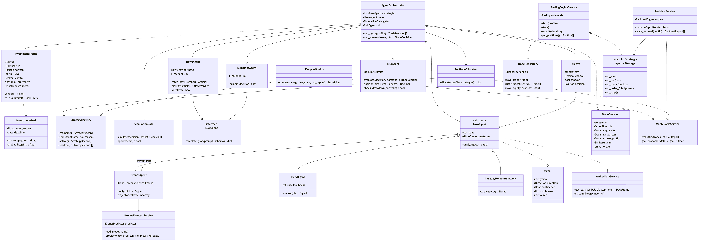
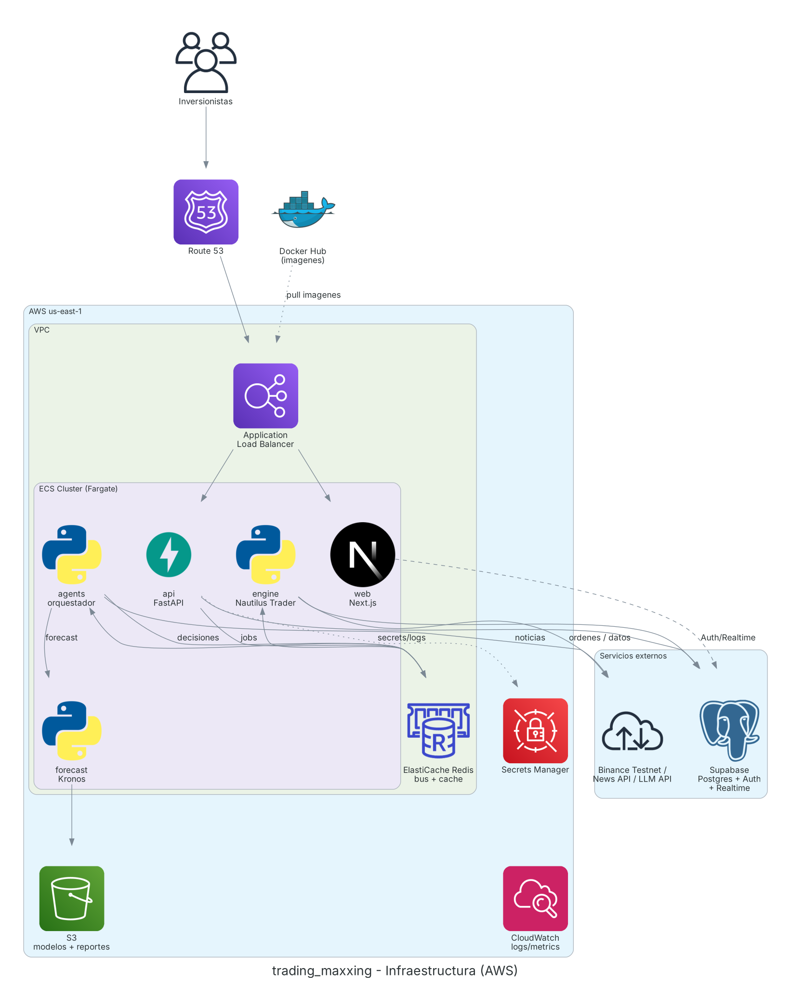
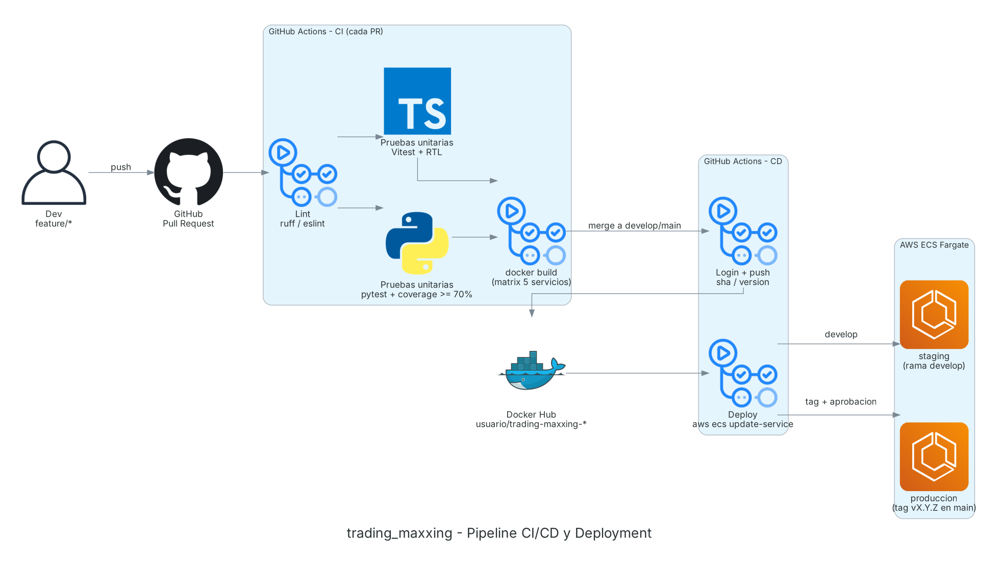
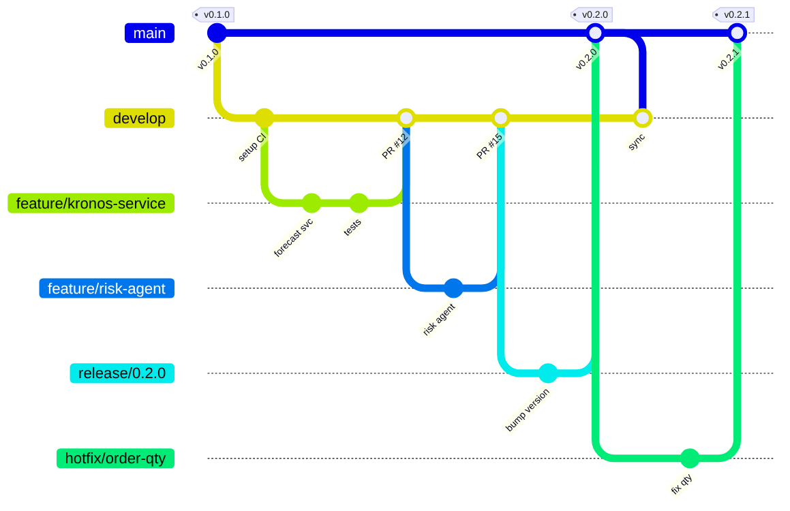

# Arquitectura

Esta página reúne los diagramas de arquitectura de trading_maxxing (clases, infraestructura, deployment y estrategia de ramas). Está pensada como complemento visual de la [Propuesta](Home) y del detalle del orquestador en [`docs/arquitectura/orquestador.md`](https://github.com/CarloSantoro21/trading_maxxing/blob/main/docs/arquitectura/orquestador.md).

El código fuente Mermaid de los diagramas vive en [`docs/propuesta/`](https://github.com/CarloSantoro21/trading_maxxing/tree/main/docs/propuesta) del repositorio.

## Diagrama de clases

Vista de alto nivel de los componentes del sistema (agentes, servicios, orquestador y persistencia) y sus relaciones.



- Fuente: [`docs/propuesta/classes.mmd`](https://github.com/CarloSantoro21/trading_maxxing/blob/main/docs/propuesta/classes.mmd)

## Infraestructura (AWS)

Despliegue en AWS con ECS Fargate, Application Load Balancer, ElastiCache Redis, Secrets Manager y S3. Todo se levanta con Terraform desde `infra/`.



- Fuente: [`docs/propuesta/infra.py`](https://github.com/CarloSantoro21/trading_maxxing/blob/main/docs/propuesta/infra.py)

| Recurso | Tipo | Propósito |
|---|---|---|
| trading-maxxing-vpc | VPC con 2 subredes públicas y 2 privadas | Aislamiento de red |
| trading-maxxing-alb | Application Load Balancer | Enruta `/` a web y `/api` a api |
| trading-maxxing-cluster | ECS Cluster (Fargate) | Ejecuta los contenedores |
| web, api, agents, forecast, engine | 5 servicios de ECS | Un servicio por contenedor |
| trading-maxxing-redis | ElastiCache Redis | Canal de decisiones y cola de jobs |
| trading-maxxing/* | Secrets Manager | Claves de Binance Testnet, Supabase, Groq y la API de noticias |
| /ecs/trading-maxxing | CloudWatch Logs y alarmas | Logs, métricas y alerta de drawdown |
| trading-maxxing-artifacts | S3 | Pesos del modelo, reportes de backtest y datos históricos |
| trading-maxxing-tfstate | S3 y DynamoDB | Estado y bloqueo de Terraform |
| github-actions-deploy | Rol IAM con OIDC | Deploy desde GitHub Actions sin llaves |

> **Local primero.** Mientras no haya go/no-go, todo corre en localhost (`docker compose`, Supabase CLI y `pnpm dev`). La nube solo se usa para la entrega final.

## Deployment y CI/CD

Pipeline en GitHub Actions. Cada pull request corre lint, pruebas y build de las 5 imágenes; los merges a `develop` publican imágenes con tag `develop` y `sha-<commit>` en Docker Hub; los tags `vX.Y.Z` sobre `main` publican `X.Y.Z` y `latest`, y el deploy a AWS y Cloudflare Pages es un workflow manual con aprobación.



- Fuente: [`docs/propuesta/deploy.py`](https://github.com/CarloSantoro21/trading_maxxing/blob/main/docs/propuesta/deploy.py)

Pruebas que corren en el CI:

- Estrategias (TrendAgent, IntradayMomentumAgent): señales correctas sobre series sintéticas con resultado conocido.
- KronosAgent y KronosForecastService: conversión de trayectorias a señal y contrato de `/predict` con un predictor simulado.
- SimulationGate y MonteCarloService: probabilidades sobre casos analíticos con solución conocida y semilla fija.
- RiskAgent: tamaño de posición por nivel de riesgo, stop-loss, take-profit y bloqueo por drawdown.
- AgentOrchestrator y PortfolioAllocator: capital por sleeve, límites de portafolio y sleeves en shadow sin órdenes.
- LifecycleMonitor y StrategyRegistry: transiciones automáticas por p95 y p99 del Monte Carlo, y promociones solo manuales.
- NewsAgent: clasificación con un LLM simulado.
- AgenticStrategy y BacktestService: órdenes correctas y reporte reproducible con BacktestEngine y datos de prueba.
- API: validación de perfiles, endpoints y autenticación.
- Web: formulario de perfil y componentes del dashboard.

Ningún pull request se fusiona con pruebas fallidas o con cobertura de Python menor a 70 %.

## Estrategia de ramas

Git Flow simplificado: `main` recibe solo `release/*` y `hotfix/*`, `develop` es la rama de integración y cada funcionalidad vive en `feature/<issue>-<descripcion>`.



- Fuente: [`docs/propuesta/branches.mmd`](https://github.com/CarloSantoro21/trading_maxxing/blob/main/docs/propuesta/branches.mmd)

Resumen:

| Rama | Uso | Sale de | Regresa a |
|---|---|---|---|
| `main` | Producción. Cada merge lleva un tag `vX.Y.Z` | — | — |
| `develop` | Integración, desplegada en staging | `main` | — |
| `feature/<issue>-<descripcion>` | Funcionalidades | `develop` | `develop` (squash merge) |
| `release/X.Y.Z` | Estabilización antes de liberar; solo correcciones | `develop` | `main` y `develop` |
| `hotfix/<descripcion>` | Correcciones urgentes en producción | `main` | `main` y `develop` |

Los commits siguen Conventional Commits y cada pull request enlaza su issue (`Closes #N`). Detalles en [CONTRIBUTING.md](https://github.com/CarloSantoro21/trading_maxxing/blob/main/CONTRIBUTING.md).

## Orquestador: capa compartida y capa por usuario

```
                 ┌──────────────── capa compartida (una vez) ────────────────┐
 velas cerradas ─▶ estrategia viva → Signal → veto de noticias → SimulationGate │──▶ tm:signals
 (MarketData)    └────────────────────────────────────────────────────────────┘
                                                                     │
                                  ReferenceService y LifecycleMonitor│  ledger de referencia
                 ┌──────────── capa por usuario (un BotRunner por bot) ───────┐
 tm:commands ───▶│ peso del sleeve × exposición del nivel × confianza          │──▶ tm:decisions
 (API)           │ → RiskAgent con los límites del nivel                       │──▶ tm:shadow
                 └────────────────────────────────────────────────────────────┘
                                                                     │
                                         engine (AgenticStrategy) ◀──┘  órdenes por bot y sleeve
```

La capa compartida calcula señales, vetos y simulación una sola vez para todos los usuarios. La capa por usuario (un `BotRunner` por bot en `running`) aplica el peso global de cada estrategia y la exposición del nivel de riesgo del usuario.

El detalle vive en [`docs/arquitectura/orquestador.md`](https://github.com/CarloSantoro21/trading_maxxing/blob/main/docs/arquitectura/orquestador.md): formato de `tm:signals`, consumidores, curvas de sensibilidad del nivel de riesgo, LifecycleMonitor, modo shadow, comandos y cómo se reinician las posiciones desde la tabla `trades`.
