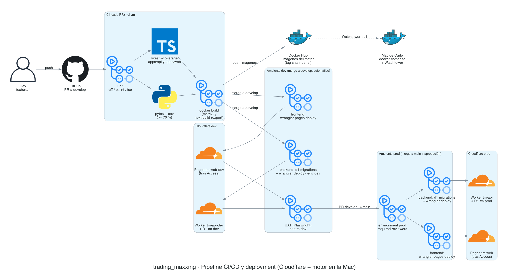
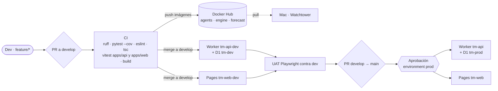

# Deployment y CI/CD

El pipeline corre en **GitHub Actions**. Cada PR pasa por el CI; el merge a `develop` despliega
**dev** de forma automática y el merge a `main` despliega **prod** después de una
**aprobación** (GitHub Environment `prod` con *required reviewers*). Backend = Worker de
Cloudflare + imágenes del motor en Docker Hub; frontend = Cloudflare Pages. Issues #27, #28 y
#45.

- Fuente: [`docs/propuesta/deploy.py`](https://github.com/CarloSantoro21/trading_maxxing/blob/develop/docs/propuesta/deploy.py) (librería `diagrams`; `python deploy.py` regenera la PNG).

## Diagrama (Mermaid)

## Pipeline del backend (#27)

1. **Build y pruebas:** `ruff` y `pytest --cov` (≥ 70 %) de los servicios de Python;
   `pnpm typecheck` y `pnpm test:coverage` de `apps/api` (vitest dentro del runtime de
   Workers con D1 local, ≥ 70 %). Reporte JUnit en la pestaña de Checks y cobertura en el *job
   summary*: es lo que se enseña en la demo ("ver el resultado de las pruebas unitarias").
2. **Docker Hub:** imágenes del motor (`trading-maxxing-{agents,engine,forecast}`) con el tag
   del SHA y el del canal; Watchtower las baja en la Mac.
3. **Dev:** merge a `develop` → `wrangler d1 migrations apply DB --env dev --remote` +
   `wrangler deploy --env dev` y verificación de `GET /api/health`. Después corre la **UAT**
   (#28).
4. **Prod:** merge a `main` → el job del environment `prod` **espera la aprobación** → mismas
   migraciones y `wrangler deploy` a producción.
5. **Rollback:** `wrangler rollback` del Worker; en el motor, fijar el tag anterior de la
   imagen.

## Pipeline del frontend (#45)

1. **Build:** `eslint`, `tsc --noEmit`, `vitest run` y `next build` con `output: "export"`
   (`pnpm check:export` valida las rutas).
2. **Dev:** merge a `develop` → `wrangler pages deploy out/ --project-name tm-web-dev`.
3. **Prod:** merge a `main` → aprobación del environment `prod` → deploy a `tm-web`.
4. La web llama a `/api/*` en su propio dominio; Pages lo reenvía al Worker por el **service
   binding `API`**, así que no hace falta `NEXT_PUBLIC_API_URL` ni CORS en la nube.
5. El header muestra el SHA corto y "DEV"/"PROD" para enseñar el cambio en la demo.

## Service connection y secretos

La rúbrica pide una *service connection*. En GitHub Actions son secrets por environment:

- **Cloudflare:** `CLOUDFLARE_API_TOKEN` (permisos de Workers, D1 y Pages) y
  `CLOUDFLARE_ACCOUNT_ID`.
- **Docker Hub:** `DOCKERHUB_USERNAME` y `DOCKERHUB_TOKEN`.
- **Worker:** `SERVICE_TOKEN` con `wrangler secret put SERVICE_TOKEN --env <env>`.

## Pruebas que corren en CI

- Estrategias (`TrendAgent`, `IntradayMomentumAgent`, `MovingAverageAgent`, `TsmomAgent`):
  señales correctas sobre series sintéticas.
- `KronosAgent` y `KronosForecastService`: trayectorias a señal y contrato de `/predict`.
- `SimulationGate` y `MonteCarloService`: casos analíticos con semilla fija.
- `RiskAgent`, `AgentOrchestrator`, `PortfolioAllocator`, `LifecycleMonitor` y
  `StrategyRegistry`.
- `NewsAgent` y `ExplainerAgent` con un LLM simulado (el LLM está apagado por defecto).
- `AgenticStrategy` y `BacktestService` con `BacktestEngine` y datos de prueba.
- API (`apps/api`): auth (modo dev y JWT de Access), filtros por usuario, admin vs member,
  endpoints internos con token y los ports numéricos.
- Web: formularios y componentes del dashboard (Vitest + React Testing Library).

Ningún pull request se fusiona con pruebas fallidas o con cobertura menor a 70 %.
