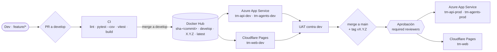

# Deployment y CI/CD

El pipeline corre en **GitHub Actions** con dos workflows separados: `backend.yml` publica el backend en **Azure App Service** y `frontend.yml` publica el frontend en **Cloudflare Pages**. Ambos tienen environments `dev` (automático al merge a `develop`) y `prod` (con aprobación manual al merge a `main`). Ver issues #27 y #45.

> **Nota sobre los diagramas:** la imagen `img/deploy.png` sigue siendo la versión vieja con íconos de AWS. El script fuente ya se reescribió a Azure + Cloudflare (`docs/propuesta/deploy.py`), pero no se ha podido regenerar la PNG en esta rama (falta Graphviz + `diagrams` en el entorno). Pendiente: correr `python docs/propuesta/deploy.py` en un entorno con `diagrams` instalado y commitear la PNG nueva. Mientras tanto, el diagrama Mermaid de abajo refleja el flujo real.

- Fuente (Azure + Cloudflare): [`docs/propuesta/deploy.py`](https://github.com/CarloSantoro21/trading_maxxing/blob/main/docs/propuesta/deploy.py).

## Diagrama (Mermaid, flujo real)

## Workflow del backend (`backend.yml`)

1. **Build**: `ruff check`, `pytest --cov` (cobertura ≥ 70 %) y `docker build` de las imágenes `trading-maxxing-{api,agents,forecast,engine}`.
2. **Resultados visibles**: reporte JUnit publicado con `dorny/test-reporter` en la pestaña de Checks, y cobertura en el *job summary*. La rúbrica pide **ver el resultado de las pruebas unitarias** en la demo.
3. **Docker Hub**: en push a `develop` o tag `vX.Y.Z`, se publica con los tags `sha-<commit>` + `develop` o `X.Y.Z` + `latest`.
4. **Dev**: al mergear a `develop`, `azure/webapps-deploy` (o `az webapp config container set`) actualiza `tm-api-dev` y `tm-agents-dev`. El job termina verificando `GET /health`.
5. **UAT**: pruebas de aceptación contra dev (#28).
6. **Prod**: al mergear a `main` (o crear un tag `vX.Y.Z`), el job del environment `prod` **espera la aprobación** de un revisor (GitHub Environments → *required reviewers*) y despliega **la misma imagen** que ya corrió en dev.
7. **Rollback**: redeploy del tag anterior desde el historial de Docker Hub.

## Workflow del frontend (`frontend.yml`)

1. **Build**: `eslint`, `tsc --noEmit`, `vitest run` y `next build` con `output: "export"`.
2. **Dev**: al mergear a `develop`, deploy automático al proyecto Pages `tm-web-dev` con `NEXT_PUBLIC_API_URL=https://tm-api-dev.azurewebsites.net`.
3. **Prod**: al mergear a `main`, environment `prod` con aprobación → deploy a `tm-web` apuntando a `https://tm-api-prod.azurewebsites.net`.

CORS en la API: permitir los dos dominios de Cloudflare Pages para que `fetch` desde el frontend funcione.

## Service connection y secretos

La rúbrica pide una *service connection*. En GitHub Actions se traduce a:

- **Azure (OIDC)**: Managed Identity federada por environment (`dev` y `prod`), sin llaves de larga duración. Ver #39.
- **Cloudflare**: `CLOUDFLARE_API_TOKEN` por environment, con permiso `Pages:Edit`.
- **Docker Hub**: `DOCKERHUB_USERNAME` y `DOCKERHUB_TOKEN` a nivel repo.

## Pruebas que corren en CI

- Estrategias (`TrendAgent`, `IntradayMomentumAgent`): señales correctas sobre series sintéticas.
- `KronosAgent` y `KronosForecastService`: conversión de trayectorias a señal y contrato de `/predict` con un predictor simulado.
- `SimulationGate` y `MonteCarloService`: probabilidades sobre casos analíticos con solución conocida y semilla fija.
- `RiskAgent`: tamaño de posición por nivel de riesgo, stop-loss, take-profit y bloqueo por drawdown.
- `AgentOrchestrator` y `PortfolioAllocator`: capital por sleeve, límites de portafolio y sleeves en shadow sin órdenes.
- `LifecycleMonitor` y `StrategyRegistry`: transiciones automáticas por p95 y p99 del Monte Carlo.
- `NewsAgent`: clasificación con un LLM simulado.
- `AgenticStrategy` y `BacktestService`: órdenes correctas y reporte reproducible con `BacktestEngine` y datos de prueba.
- API: validación de perfiles, endpoints y autenticación.
- Web: formulario de perfil y componentes del dashboard.

Ningún pull request se fusiona con pruebas fallidas o con cobertura de Python menor a 70 %.
