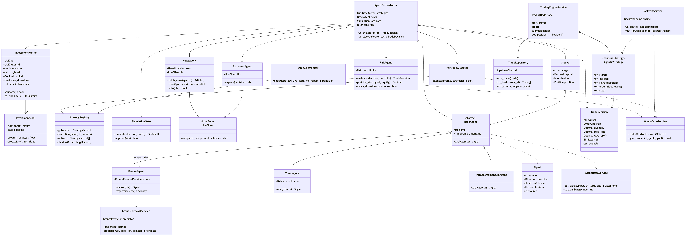
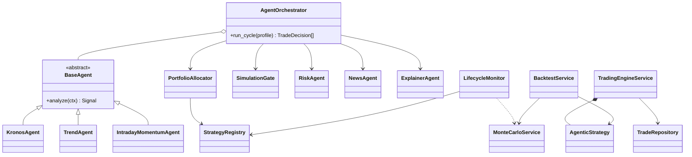

# Diagrama de clases

Vista de alto nivel de los componentes del sistema (agentes, servicios, orquestador y persistencia) y sus relaciones. El código fuente del diagrama está en [`docs/propuesta/classes.mmd`](https://github.com/CarloSantoro21/trading_maxxing/blob/main/docs/propuesta/classes.mmd).

> Si la imagen PNG no está sincronizada con la última versión del `.mmd`, el fuente Mermaid es siempre la fuente de verdad. Pendiente: regenerar la PNG a partir del `.mmd` con Mermaid CLI (`mmdc -i classes.mmd -o img/classes.png`).

## Componentes principales

| Componente | Responsabilidad | Motor | Métodos principales |
|---|---|---|---|
| web (Next.js) | Onboarding, perfil, dashboard, backtests | — | `/onboarding`, `/dashboard`, `/strategies`, `/backtests`, `/trades` |
| api (FastAPI) | API REST, validación, disparo de jobs | — | `POST /profiles`, `GET /portfolio`, `POST /backtests`, `POST /bots/{id}/start`, `POST /bots/{id}/stop`, `GET /trades` |
| InvestmentProfile | Capital, nivel de riesgo (1 a 5) y metas del usuario | Python | `validate()`, `to_risk_limits()` |
| InvestmentGoal | Metas de rendimiento | Python | `progress(equity)`, `probability(sim)` |
| BaseAgent (abstracta) | Contrato común de las estrategias | — | `analyze(ctx) -> Signal` |
| KronosAgent | Señal y trayectorias a partir de Kronos | Kronos-small | `analyze(ctx)`, `trajectories(ctx)` |
| TrendAgent | Trend following con canales Donchian | Python | `analyze(ctx)` |
| IntradayMomentumAgent | Momentum de la primera a la última media hora | Python | `analyze(ctx)` |
| NewsAgent | Veto ante noticias de alto impacto | LLM (Groq) | `fetch_news(symbol)`, `classify(articles)`, `veto(ctx)` |
| AgentOrchestrator | Ciclo por vela: corre cada sleeve activo y en shadow | Python | `run_cycle(profile)`, `run_sleeve(sleeve, ctx)` |
| PortfolioAllocator | Pesos globales por estrategia y exposición por usuario según su nivel de riesgo | Python | `weights(strategies)`, `allocate(profile, weights) -> dict[str, Decimal]` |
| StrategyRegistry | Estado del ciclo de vida de cada estrategia (tabla `strategies`) | Python + Supabase | `get(name)`, `transition(name, to, reason)`, `active()`, `shadow()` |
| LifecycleMonitor | Detecta deterioro en vivo y degrada estrategias | Python | `check(strategy, live_stats, mc_report) -> Transition` |
| SimulationGate | Monte Carlo antes de cada operación | numpy | `simulate(decision, paths) -> SimResult`, `approve(sim)` |
| RiskAgent | Tamaño de posición y límites | Python | `evaluate(decision, portfolio)`, `position_size(signal, equity)`, `check_drawdown(portfolio)` |
| ExplainerAgent | Justificación en lenguaje natural (fuera del camino de la decisión) | LLM | `explain(decision) -> str` |
| LLMClient | Interfaz común para proveedores de LLM | Groq | `complete_json(prompt, schema)` |
| KronosForecastService | Inferencia de Kronos | Kronos | `load_model(name)`, `predict(ohlcv, pred_len, samples)` |
| MarketDataService | Velas históricas y en tiempo real | Python | `get_bars(symbol, tf, start, end)`, `stream_bars(symbol, tf)` |
| TradingEngineService | Envuelve el TradingNode de Nautilus | Nautilus | `start(profile)`, `stop()`, `submit(decision)`, `get_positions()` |
| AgenticStrategy | Convierte decisiones en órdenes | Nautilus | `on_start()`, `on_bar(bar)`, `on_signal(decision)`, `on_order_filled(event)`, `on_stop()` |
| BacktestService | Backtests in-sample y out-of-sample | Nautilus | `run(config) -> BacktestReport`, `walk_forward(config)` |
| MonteCarloService | Remuestreo de operaciones y proyección de metas | numpy | `reshuffle(trades, n)`, `goal_probability(stats, goal)` |
| TradeRepository | Persistencia en Supabase | Python | `save_trade(trade)`, `list_trades(user_id)`, `save_equity_snapshot(snap)` |

## Esqueleto en Mermaid (resumen)

El `.mmd` completo vive en [`docs/propuesta/classes.mmd`](https://github.com/CarloSantoro21/trading_maxxing/blob/main/docs/propuesta/classes.mmd); esta vista muestra solo las relaciones principales para que la Wiki también pueda renderizarla sin depender de la PNG.

## Flujo de una operación

Fase 1, laboratorio (antes de que una estrategia opere):

1. `MarketDataService` descarga la historia de BTC/USDT y ETH/USDT de Binance.
2. `BacktestService` corre un walk-forward con comisiones y slippage: optimiza en 12 meses (in-sample), prueba en los 3 siguientes (out-of-sample) y avanza 3 meses.
3. `MonteCarloService` remuestrea los retornos del sleeve 10,000 veces y obtiene la distribución del drawdown máximo.
4. La estrategia se aprueba solo si cumple criterios fijos (Sharpe > 0.5, drawdown p95 ≤ 40 %, ≥ 100 operaciones). Si los cumple, pasa a **shadow**.

Fase 2, producción (en cada cierre de vela):

1. El orquestador arma el contexto y ejecuta las estrategias activas o en shadow.
2. `NewsAgent` clasifica noticias y puede vetar entradas.
3. Las señales se publican una sola vez en Redis. Cada bot (portafolio de un usuario) las ejecuta en su sleeve.
4. `SimulationGate` bloquea operaciones con valor esperado negativo.
5. `RiskAgent` calcula el tamaño de la posición y SL/TP.
6. `AgenticStrategy` envía la orden bracket a Binance Testnet.
7. La operación se guarda en Supabase y el dashboard se actualiza con Supabase Realtime.
