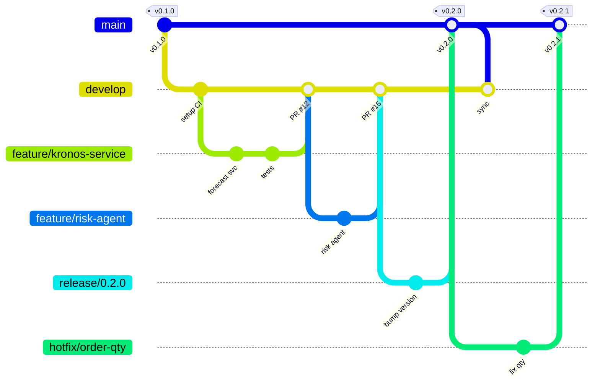

# Estrategia de ramas

Git Flow simplificado: `main` recibe solo `release/*` y `hotfix/*`, `develop` es la rama de integración (y despliega a los ambientes de dev) y cada funcionalidad vive en `feature/<issue>-<descripcion>`. El detalle procedimental vive en [CONTRIBUTING.md](https://github.com/CarloSantoro21/trading_maxxing/blob/main/CONTRIBUTING.md).


- Fuente: [`docs/propuesta/branches.mmd`](https://github.com/CarloSantoro21/trading_maxxing/blob/main/docs/propuesta/branches.mmd)

## Diagrama (Mermaid, inline)



## Resumen de ramas

| Rama | Uso | Sale de | Regresa a | Ambiente |
|---|---|---|---|---|
| `main` | Producción. Cada merge lleva un tag `vX.Y.Z` | — | — | **prod** (Worker `tm-api` + D1 `tm-prod` y Pages `tm-web`) |
| `develop` | Integración | `main` | — | **dev** (Worker `tm-api-dev` + D1 `tm-dev` y Pages `tm-web-dev`) |
| `feature/<issue>-<descripcion>` | Funcionalidades | `develop` | `develop` (squash merge) | CI en PR |
| `release/X.Y.Z` | Estabilización antes de liberar | `develop` | `main` y `develop` | CI en PR |
| `hotfix/<descripcion>` | Correcciones urgentes en producción | `main` | `main` y `develop` | CI en PR |

## Reglas

- Los commits siguen **Conventional Commits** (`feat:`, `fix:`, `docs:`, `test:`, `ci:`, etc.).
- Cada pull request **enlaza su issue** (`Closes #N`) y se fusiona con **squash merge**.
- `develop` no es la rama por defecto del repo, así que `Closes #N` **no cierra el issue automáticamente**: hay que cerrarlos a mano al fusionar.
- Las ramas `main` y `develop` (de este repo y de `trading_maxxing-infra`) están protegidas: PR obligatorio sin push directo, checks de CI en verde, conversaciones resueltas, sin force push ni borrado. No se exigen aprobaciones para no bloquear al equipo y la regla no aplica a administradores para poder intervenir en una emergencia. Los checks requeridos están en [CONTRIBUTING.md → Protección de ramas](https://github.com/CarloSantoro21/trading_maxxing/blob/main/CONTRIBUTING.md#protección-de-ramas).

## Mapa con los ambientes

```
feature/*  ──PR──▶  develop  ──auto──▶  Worker dev        +  Cloudflare Pages dev
                      │                 (tm-api-dev)         (tm-web-dev)
                      │
                      │  release/X.Y.Z  o  merge directo
                      ▼
                     main   ──aprobación──▶  Worker prod       +  Cloudflare Pages prod
                                              (tm-api)            (tm-web)
```
