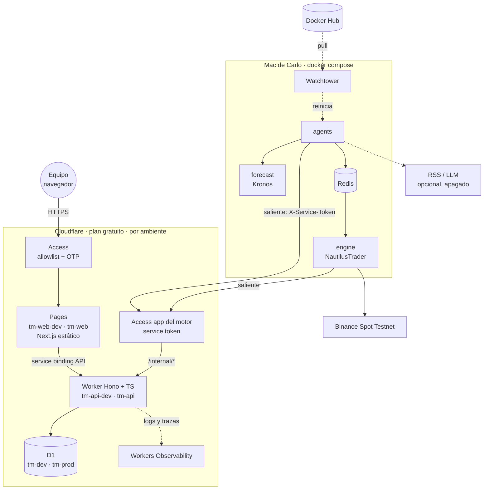

# Infraestructura (Cloudflare + motor en la Mac)

Arquitectura final (21 de noviembre de 2026): todo lo público vive en **Cloudflare, plan
gratuito** (Pages, Workers con Hono, D1, Access y Workers Observability), sin Supabase. El
**motor** (agents, engine con NautilusTrader, forecast con Kronos y Redis) corre en la **Mac de
Carlo** con `docker compose`, imágenes de **Docker Hub** y **Watchtower**, y solo hace
conexiones de salida. Detalle completo en
[`docs/arquitectura/cloudflare.md`](https://github.com/CarloSantoro21/trading_maxxing/blob/develop/docs/arquitectura/cloudflare.md).

- Fuente: [`docs/propuesta/infra.py`](https://github.com/CarloSantoro21/trading_maxxing/blob/develop/docs/propuesta/infra.py) (librería `diagrams`; `python infra.py` regenera la PNG).
- Terraform: repo [`trading_maxxing-infra`](https://github.com/CarloSantoro21/trading_maxxing-infra) (provider `cloudflare/cloudflare`, `envs/dev` y `envs/prod`).

## Diagrama (Mermaid)

## Recursos por ambiente

| Recurso | Tipo | dev | prod | Lo crea |
|---|---|---|---|---|
| Frontend | Cloudflare Pages | `tm-web-dev` (rama `develop`) | `tm-web` (rama `main`) | Terraform (proyecto) + `wrangler pages deploy` (contenido) |
| API | Cloudflare Worker (Hono + TypeScript) | `tm-api-dev` | `tm-api` | `wrangler deploy` desde el pipeline |
| Base de datos | Cloudflare D1 | `tm-dev` | `tm-prod` | Terraform; migraciones con `wrangler d1 migrations apply` |
| Login | Access app (self-hosted) delante del dominio de Pages, allowlist de correos y One-time PIN | sí | sí | Terraform |
| Acceso del motor | Access app sobre `/internal/*` con *service token* | sí | sí | Terraform |
| APM | Workers Observability (logs, trazas, errores) | sí | sí | `[observability]` en `wrangler.toml` |
| Imágenes | Docker Hub `trading-maxxing-{agents,engine,forecast}` | canal dev | canal prod | pipeline (#27) |
| Motor | Mac: `docker compose` + Watchtower | `TM_API_URL` → `tm-api-dev` | `TM_API_URL` → `tm-api` | Carlo (#116) |

Outputs de Terraform que consumen los pipelines y el motor: `d1_database_id`,
`pages_project_name`, `access_team_domain`, `access_web_aud`,
`motor_service_token_client_id` y `motor_service_token_secret`.

**Costo: 0 USD.** Todo cabe en el plan gratuito de Cloudflare (Workers: 100 000 requests al
día y 10 ms de CPU por invocación; D1: 5 GB; Access: hasta 50 usuarios).

## Por qué el motor corre en la Mac

- Python en Workers corre sobre **Pyodide**: no carga paquetes nativos como **NautilusTrader**
  (Rust/Cython) ni **PyTorch** (Kronos).
- Workers **no tiene procesos permanentes**; el `TradingNode` necesita websockets abiertos
  con Binance todo el día.
- Límites del plan gratuito: **128 MB** de memoria y **10 ms de CPU** por invocación.

## Cuando paguemos: Cloudflare Containers

Con Workers Paid (5 USD al mes) el motor se mueve a **Cloudflare Containers** con las **mismas
imágenes**: un **Durable Object supervisor** las arranca y mantiene vivas, Redis va como
contenedor (o se cambia por **Queues**), la API y el motor se hablan por **service binding
interno** y el panel da **CPU y memoria por contenedor**. Ojo con la **región**: Binance
bloquea IPs de EE. UU., así que los contenedores tienen que arrancar fuera de EE. UU.

## Autenticación y secretos

- **Usuarios ↔ web:** Cloudflare Access (OTP por correo, allowlist). El Worker valida el JWT
  de Access y busca el correo en la tabla `users` de D1 (roles `admin` y `member`).
- **Motor ↔ API:** header `X-Service-Token` (`TM_SERVICE_TOKEN`) y, si la app de Access está
  activa, `CF-Access-Client-Id` / `CF-Access-Client-Secret`.
- **GitHub Actions ↔ Cloudflare:** `CLOUDFLARE_API_TOKEN` y `CLOUDFLARE_ACCOUNT_ID` por
  environment.
- **GitHub Actions ↔ Docker Hub:** `DOCKERHUB_USERNAME` y `DOCKERHUB_TOKEN`.
- **Mac:** `.env` local (Binance Testnet, `TM_*`, `CF_ACCESS_*`); nunca en git.

## Monitoreo

Workers Observability muestra logs estructurados, trazas, errores (con el endpoint de demo
`POST /api/admin/debug/error`) y, en las métricas del Worker, requests, errores, CPU time y
duración. Workers no reporta memoria: en la demo se complementa con `docker stats` de los
contenedores de la Mac (ver #29).
