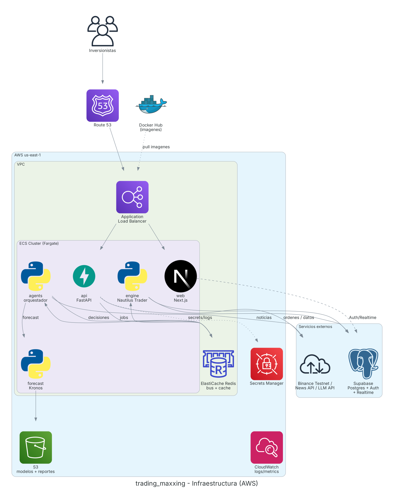
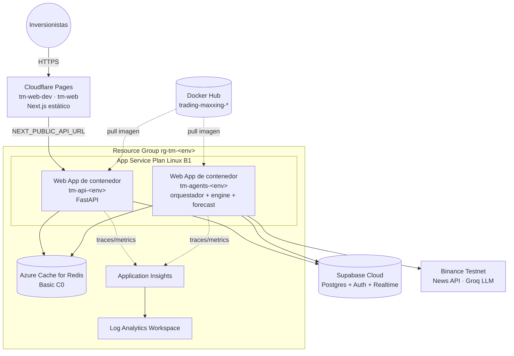

# Infraestructura (Azure + Cloudflare)

El backend se despliega en **Azure App Service** y el frontend en **Cloudflare Pages**. El código Terraform vive en un repo separado (`trading_maxxing-infra`, ver #26) con el provider `azurerm`, módulos por recurso y dos ambientes (`envs/dev` y `envs/prod`).

> **Nota sobre los diagramas:** la imagen `img/infra.png` sigue siendo la versión vieja con íconos de AWS. El script fuente ya se reescribió a Azure + Cloudflare (`docs/propuesta/infra.py`), pero no se ha podido regenerar la PNG en esta rama (falta Graphviz + `diagrams` en el entorno). Pendiente: correr `python docs/propuesta/infra.py` en un entorno con `diagrams` instalado y commitear la PNG nueva. Mientras tanto, el diagrama Mermaid de abajo refleja la arquitectura real.

- Fuente (Azure + Cloudflare): [`docs/propuesta/infra.py`](https://github.com/CarloSantoro21/trading_maxxing/blob/main/docs/propuesta/infra.py).

## Diagrama (Mermaid, Azure + Cloudflare)

## Recursos por ambiente

| Recurso | Tipo | Propósito |
|---|---|---|
| `rg-tm-<env>` | Azure Resource Group | Aísla los recursos de dev y prod |
| `asp-tm-<env>` | App Service Plan Linux **B1** | Soporta las dos Web Apps del ambiente |
| `tm-api-<env>` | Web App (Linux Container) | FastAPI; URL `https://tm-api-<env>.azurewebsites.net` |
| `tm-agents-<env>` | Web App (Linux Container) | Orquestador, engine y forecast en el mismo contenedor |
| `appi-tm-<env>` | Application Insights | APM: traces, errores y requests para la demo |
| `log-tm-<env>` | Log Analytics Workspace | Backend de App Insights y logs de App Service |
| `redis-tm-<env>` | Azure Cache for Redis Basic C0 | Bus de mensajería y cache |
| App settings / Key Vault | Variables `sensitive` | Supabase URL y service role, Binance Testnet, Groq, CryptoPanic |
| `tm-web` / `tm-web-dev` | Cloudflare Pages | Frontend estático en `*.pages.dev` |

La base de datos está en **Supabase Cloud, plan gratuito**, con un proyecto para dev y otro para prod. Esto es intencional (RLS y Realtime son parte del diseño del producto).

Cuenta: **Azure for Students** con correo del ITESO (100 USD de crédito, sin tarjeta). Costo estimado: dos planes B1 (~13 USD al mes cada uno) + Azure Cache for Redis Basic C0. Fuera de ventanas de demo, el ambiente de dev se puede destruir con `terraform destroy`.

> **Local primero.** El desarrollo y la validación corren en localhost (`docker compose`, Supabase CLI, `pnpm dev`). La nube es obligatoria para la entrega del 6 de diciembre (ver #26, #27, #45).

## Autenticación y secretos

- **GitHub Actions ↔ Azure:** OIDC con una Managed Identity por ambiente; sin llaves de larga duración (ver #39).
- **GitHub Actions ↔ Cloudflare:** API Token con permiso `Pages:Edit` por ambiente.
- **GitHub Actions ↔ Docker Hub:** secrets `DOCKERHUB_USERNAME` y `DOCKERHUB_TOKEN`.
- **App settings de la Web App:** variables `SUPABASE_URL`, `SUPABASE_SERVICE_ROLE_KEY`, `BINANCE_API_KEY`, `BINANCE_API_SECRET`, `GROQ_API_KEY`, etc., marcadas como `sensitive` en Terraform. Opcional: Azure Key Vault con referencia desde las app settings.

## Monitoreo

Application Insights recoge trazas y errores del backend. En el portal de Azure el App Service Plan expone CPU y memoria (criterios de la rúbrica). Los logs de la Web App (`stdout` / `stderr`) se enlazan al Log Analytics Workspace para búsquedas con KQL.
